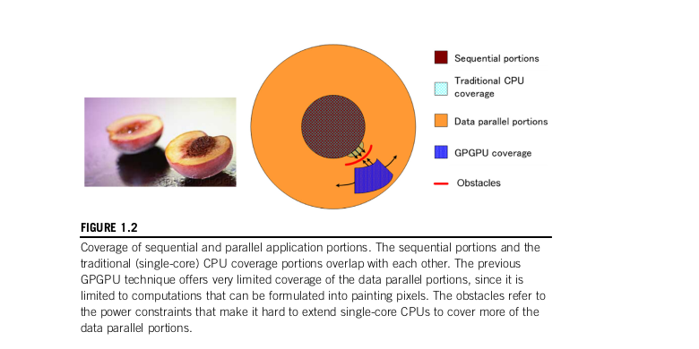

# 1.3 Speeding Up Real Applications

When writing parallel code for a GPU, the primary objective is increasing execution speed. Key considerations include the achievable speedup magnitude and the fundamental architectural constraints governing performance scaling.

Understanding performance scaling requires analyzing speedup calculation formulas, the theoretical upper bounds defined by Amdahl's Law, the scaled-workload perspective of Gustafson's Law, and the architectural trade-offs between Latency and Throughput.

---

## 1. What is "Speedup"?

Prior to mathematical derivations, **speedup** is formally defined:

Speedup is just the ratio of the time an application takes on an old system compared to a new system.

* **Formula:** `Speedup = (Time on Old System) / (Time on New System)`

**Example:**
If an application requires 200 seconds to execute on a baseline CPU (System B), and 10 seconds on an accelerated GPU (System A):

* Speedup = 200 / 10 = **20x speedup** (indicating execution is 20 times faster).

---

## 2. Amdahl's Law (The Time-Based Speedup)

A common misconception is that deploying a GPU with 100x higher raw arithmetic throughput will cause an entire application to finish 100x faster. **This is false.**

Amdahl's Law measures the acceleration of a *fixed, predetermined workload*. It establishes that the maximum speedup of an application is strictly constrained by the portion of the code that *cannot* be parallelized (the serial fraction).

Every application is split into two parts:

1. **Serial/Sequential Portion ($T_s$):** Code that must run one step at a time.
2. **Parallel Portion ($T_p$):** Math-heavy code where calculations can happen simultaneously.

### The Math of Amdahl's Law

Amdahl's speedup ($S_a$) focuses on the **ratio of time**.
$$
S_a = \frac{T_s + T_p}{T_s + \frac{T_p}{n}}
$$
*(Where $n$ is the number of cores/threads)*

For example, consider a program with 10% serial execution ($T_s = 0.1$) and 90% parallel execution ($T_p = 0.9$), executed across 28 threads ($n = 28$):

* $S_a = \frac{1}{0.1 + (0.9 / 28)} \approx 7.5x \text{ faster}$

Even with 28 threads, the maximum theoretical speedup is limited to 7.5x. As the parallel duration shrinks, the 10% serial portion dominates the execution timeline, forming an asymptotic speedup ceiling.

### The Gamer's Case-Study (Amdahl's Realm)

In rendering a video game frame, the problem size is **fixed**. One specific frame must be computed within a fixed deadline.
If the physics simulation engine is serialized, thread availability (whether 28 threads or 10,000 threads) cannot overcome the serialized execution time. The frame cannot complete until the serial physics thread finishes.

This is exactly why PC gamers prefer CPUs like the Intel i7-14700K over massive 64-core Server CPUs. The i7-14700K has **Performance Cores (P-Cores)** with extremely high clock speeds to finish that serial part ($T_s$) as fast as physically possible.

---

## 3. Gustafson's Law (The Work-Based Speedup)

Amdahl's Law assumes a static, fixed workload. John Gustafson observed that when higher-performance parallel hardware is deployed, problem sizes are scaled proportionally to exploit available compute capacity.

Gustafson's Law measures **how much MORE work is done in the same amount of time.**

### The Math of Gustafson's Law

Rearranging the execution time equation to evaluate the *volume of work completed* within a constant timeframe yields Gustafson's speedup ($S_g$):
$$
S_g = T_s + n(T_p)
$$

Let's use the exact same scenario: 10% serial ($T_s = 0.1$), 90% parallel ($T_p = 0.9$), on 28 threads ($n = 28$).

* $S_g = 0.1 + 28(0.9) = 25.3x \text{ more work}$

**Why the Gap? (7.5x vs 25.3x)**
Under Amdahl's assumptions, the 10% serial fraction dominates as parallel execution time shrinks. Under Gustafson's model, scaling the parallel workload ensures the constant serial portion occupies a progressively smaller percentage of total computation.

### The Data Scientist Case-Study (Gustafson's Realm)

Imagine a data scientist processing 100GB of data. On 1 core, it takes 100 hours.

* **Using Amdahl's view:** They use 28 threads to try and finish that 100GB in 4 hours. But the serial setup time dominates, bottlenecking the speed.
* **Using Gustafson's view:** They realize they have 28 threads, so instead of just processing 100GB faster, they process **2.8 Terabytes** in the same 100 hours!

Because initialization and serial setup time remain largely constant whether processing 1 GB or 1 TB, parallel hardware efficiency increases significantly as the dataset scales.

---

## 4. Extreme Cases: Are Both Laws the Same Reality?

Yes! Both laws mathematically conclude that **serial code is the enemy**.

1. **If $T_s = 1.0$ (100% Serial Code):**
    * Amdahl Speedup = $\frac{1}{1 + 0} = 1$ (No speedup)
    * Gustafson Speedup = $1 + 28(0) = 1$ (No extra work done)
2. **If $T_s = 0.0$ (100% Parallel Code):**
    * Amdahl Speedup = $\frac{1}{0 + \frac{1}{n}} = n$
    * Gustafson Speedup = $0 + n(1) = n$

**The Core Takeaway:**

* **Amdahl's Law** defines the speedup limit for a *fixed problem size*.
* **Gustafson's Law** quantifies the computational scaling potential when *expanding problem sizes to utilize hardware capacity*.

---

## 5. Determining the Empirical Parallel Fraction

Determining whether an application is 90% or 50% parallel requires **computational profiling**.

Under Linux, performance profilers such as `perf` or NVIDIA Nsight Systems identify the runtime distribution across functions, revealing whether execution scales across cores or stalls on serialized bottlenecks.

**Reverse-Engineering Amdahl's Law:**
The empirical parallel fraction ($P$) can be derived by measuring execution time on 1 thread ($T_1$) and on $n$ threads ($T_n$). Applying the measured speedup to the inverted Amdahl formulation yields:
$$
P = \frac{n \times (\text{Speedup} - 1)}{\text{Speedup} \times (n - 1)}
$$

**The Proof (Deriving $P$ from Amdahl's Law):**
Let $S$ be Speedup, $P$ be the parallel fraction, and $n$ be the number of threads.

1. Start with Amdahl's Law: $S = \frac{1}{(1-P) + \frac{P}{n}}$
2. Take the reciprocal of both sides: $\frac{1}{S} = (1-P) + \frac{P}{n}$
3. Rearrange to isolate the $P$ terms: $\frac{1}{S} - 1 = -P + \frac{P}{n}$
4. Factor out $P$: $\frac{1 - S}{S} = P \left( \frac{1}{n} - 1 \right)$
5. Find a common denominator inside the parenthesis: $\frac{1 - S}{S} = P \left( \frac{1 - n}{n} \right)$
6. Multiply both sides by $-1$ to flip the signs: $\frac{S - 1}{S} = P \left( \frac{n - 1}{n} \right)$
7. Isolate $P$ by multiplying both sides by $\frac{n}{n - 1}$: $P = \frac{n \times (S - 1)}{S \times (n - 1)}$

---

## 6. Latency vs. Throughput (The Cost of Speed)

Analyzing architectural divergence between CPUs and GPUs requires contrasting the two primary strategies for accelerating computation.

| Feature | Increasing Throughput (GPU Style) | Reducing Latency (CPU Style) |
| :--- | :--- | :--- |
| **Strategy** | Add more "Chefs" (Cores) | Make one "Chef" move faster |
| **Chip Area** | Scales Linearly (Add 1 core, get 1 core) | Scales Poorly (Double the area, only get ~1.5x speed) |
| **Power Cost** | Linear (Double the cores = Double power) | Exponential (Cutting time in half requires quadruple power) |
| **Philosophy**| Optimize for *many* threads | Optimize for *one* fast thread |

### The Expensive Cost of Latency

**Reducing latency is much more expensive than increasing throughput.**
Doubling arithmetic throughput primarily involves duplicating Arithmetic Logic Units (ALUs) across the silicon—a linear area-to-compute trade-off.

Making a *single* core finish calculations faster requires incredibly complex, power-hungry engineering. This explains why CPU cores are so much bigger and hotter than GPU cores.

### The i7-14700K Hybrid Architecture

Modern processors like the Intel i7-14700K elegantly combine both philosophies:

* **8 P-Cores (Performance):** Latency-optimized cores. They dedicate substantial silicon area and power to executing serial code ($1-P$) with minimum latency, mitigating the serial bottleneck.
* **12 E-Cores (Efficient):** Throughput-optimized cores. Their compact footprint enables high core density, accelerating the data-parallel portion ($P$) with high energy efficiency.

---

## 7. Clock Speed, IPC, and The Conveyor Belt Analogy

Microprocessor clock frequencies are commonly specified in Gigahertz (GHz). Formally:

Inside the CPU, there is an internal drummer (a quartz crystal oscillator). It sends out a steady pulse of electricity—a square wave—to the entire chip. Nothing happens without a clock pulse; it is the "GO!" signal for transistors to fetch, decode, execute, and store instructions.

* $1 \text{ Hertz (Hz)} = 1 \text{ pulse per second}$
* $5.6 \text{ GHz} = 5.6 \text{ billion pulses (ticks) every single second}$

**(Note: In microarchitecture analysis, execution duration is governed by Clock Cycle Time ($T$). For a 5.6 GHz processor, $T = \frac{1}{5,600,000,000} \approx 0.178 \text{ nanoseconds per cycle}$).**

### Does 5.6 GHz mean 5.6 Billion Instructions per second?

**No.** It means 5.6 billion *clock cycles* per second. The actual number of instructions depends on **IPC (Instructions Per Cycle)**. Modern processors are *superscalar*, meaning they have multiple execution units inside a single core. If a P-Core has an IPC of 5, it is actually retiring $5.6 \times 5 = 28 \text{ billion}$ instructions per second!

### The Factory Conveyor Belt Analogy (Why Stalls Matter)

Evaluating performance solely by clock frequency is insufficient because **different instructions require different cycle counts**.

Think of 5.6 GHz as the speed of a conveyor belt in a factory:

* **The Clock (5.6 GHz):** The belt moves exactly 5.6 billion times a second.
* **The Instructions:** The products being placed on the belt.
* **High IPC:** If the workers (transistors) are fast, they place a product on every slot of the belt (e.g., simple `ADD 1+1` math).
* **Memory Stalls:** If the factory runs out of parts (Memory Latency/Waiting for RAM), the belt *still moves* at 5.6 GHz, but the slots are completely empty (Zero Instructions passing through).

If execution stalls on DRAM memory latency, a 5.6 GHz clock frequency yields zero performance gain during stall cycles.

---

## 8. The "Peach" Analogy (Figure 1.2)

To conceptualize application decomposition between CPUs and GPUs, the textbook introduces the "Peach" analogy, representing how computational workloads partition across heterogeneous execution hardware.

*Figure 1.2: Coverage of sequential and parallel application portions. The peach pit represents the sequential code, and the flesh represents the parallel code.*

### Where is the Sky-Blue "Traditional CPU Coverage"?

A common point of confusion when looking at this diagram is trying to find the sky-blue color for "Traditional CPU coverage" mentioned in the legend. **It is actually not visible** because it is completely hidden underneath the maroon/dark brown circle in the center.

As the diagram's text states: *"The sequential portions and the traditional (single-core) CPU coverage portions overlap with each other."* Because they perfectly overlap, the maroon "Sequential portions" layer is drawn directly over the sky-blue "Traditional CPU coverage" layer, making it impossible to see the blue in this diagram.

### Breaking Down the Picture Deeper

Let's look closely at exactly what each part of this peach represents, including the arrows and obstacles:

1. **The Peach Pit (Maroon Center) = Sequential Portions:**
    * **What it means:** This represents code that must be run step-by-step, one instruction at a time (e.g., initializing variables or checking user logins).
    * **The Analogy:** The textbook describes attempting to parallelize sequential portions as "biting into the peach pit." Attempting to split serialized control flow across thousands of parallel GPU threads yields severe stalls and serialization penalties.
    * **The Hardware:** Traditional CPUs are excellent at handling this hard, dense "pit" because they have very fast clock speeds and complex logic units optimized for single-threaded speed. While sequential portions may constitute a large percentage of source code lines, they typically represent a small percentage of total compute operations in heavy scientific or graphics workloads.

2. **The Peach Flesh (Orange Area) = Data Parallel Portions:**
    * **What it means:** This represents sections of code where the exact same mathematical operation needs to be done on thousands or millions of independent data points simultaneously (e.g., adding color values to millions of pixels in an image, or multiplying massive matrices).
    * **The Analogy:** This is the soft, easy-to-digest "flesh" of the application. It is highly abundant in heavy applications (like games or AI) and is incredibly **easy to parallelize** because the data doesn't depend on each other.

3. **The Small "Bump" Coming Out of the Brown Center:**
    * **What it portrays:** A small brown section extending out from the main central circle towards the bottom right represents an attempt by **traditional single-core CPUs** to expand and take over some of the data-parallel (orange) work.

4. **The Red Marks = Obstacles:**
    * **What it means:** Look closely at the small brown bump, there are red barrier lines or "walls" on and around it. These symbolize the **physical and chemical limitations of hardware**, specifically **power and heat constraints** (often called the "power wall").
    * **The Analogy:** They form a barrier keeping traditional single-core CPUs from extending out to cover the data-parallel orange flesh. Because making traditional CPUs run faster requires too much power and generates too much heat, hardware designers had to switch to many-core architectures (GPUs) to tackle the rest of the peach.

5. **The Small Blue Wedge = GPGPU Coverage:**
    * **What it means:** GPGPU stands for *General-Purpose computing on Graphics Processing Units*.
    * **The Analogy:** The small blue wedge shows early GPGPU capabilities. It covers only a tiny sliver of the orange flesh because early GPUs could only handle data parallel problems if programmers strictly tricked the system into treating the data like graphics/pixels.

6. **The Two Opposite Arrows Coming Out of the Blue GPGPU Wedge:**
    * **What they portray:** The two arrows pointing out from the sides of the blue wedge show the **direction of growth** as programmers tried to expand what a graphics card could do.
    * **The Conflict:** Notice how those two arrows are pointing directly *away* from the GPGPU wedge, but they immediately run right into the **red obstacle lines** on one side. They represent the struggle of early developers trying to force non-graphics math into a graphics-only hardware setup, finding themselves blocked by how hard it was to write graphics-tricked code.

7. **The Large Blue Arc/Arrows Wrapping Around the Circle = CUDA Programming Interface:**
    * **What it means:** **CUDA** is Nvidia's modern parallel computing platform.
    * **The Analogy:** This long, sweeping blue line with arrows on both ends represents CUDA. Unlike early GPGPU methods that got stuck or the CPU bump that got blocked by the red walls, **CUDA breaks through**. The sweeping blue arrows show CUDA expanding freely in both directions across the orange flesh. It portrays **scalability**—meaning it successfully sweeps across and unlocks the vast majority of the data-parallel "peach flesh" that traditional CPUs could never reach, allowing programmers to easily write standard C/C++ code to run on a GPU.

---

## 9. Real-World Hardware Architecture: NVIDIA GeForce RTX 3060 (Ampere)

Applying these latency and throughput principles to production hardware, consider the physical specifications of the **NVIDIA GeForce RTX 3060** (GA106 silicon die, Ampere architecture):

* **SMs (Streaming Multiprocessors):** 28
* **L2 Cache:** ~3 MiB
* **CUDA Cores per SM:** 128
* **Total CUDA Cores:** $28 \times 128 = \mathbf{3,584}$
* **Tensor Cores per SM:** 4
* **Total Tensor Cores:** $28 \times 4 = \mathbf{112}$ (These are specialized units for Matrix math/AI).

### What Actually is a "Thread"?

Before calculating total concurrency, the formal definition of a thread in hardware must be clarified:

**A thread is a software abstraction, not a physical hardware wire.**
A thread is simply a sequential stream of execution.
It consists of :

1. **A Program Counter (PC):** A "bookmark" that keeps track of exactly which line of code this specific thread is currently reading.
2. **A Set of Registers:** A tiny, ultra-fast memory bank that holds the local variables and math results this thread is currently calculating.
3. **Execution State:** The current context of the thread.

GPU thread management refers directly to the hardware capacity for storing program counters, register state, and execution contexts concurrently on-chip.

### "Managed" Threads vs. "Executed" Threads (Per Cycle)

Ampere SMs schedule and execute threads in groups of 32, designated as a **Warp**.

* One Ampere SM can manage a maximum of **48 Warps** at the same time.
* $48 \text{ warps} \times 32 \text{ threads} = \mathbf{1,536 \text{ threads per SM}}$.
* Total Threads across the whole GPU: $28 \text{ SMs} \times 1,536 = \mathbf{43,008 \text{ concurrent threads}}$.

While $28 \times 1536 = 43,008$ concurrent threads reside on-chip, this does not imply that 43,008 instructions execute simultaneously in a single clock cycle.

**No. Here is where the magic of Latency Hiding comes in.**

1. **Executing per Clock Cycle:**
    Inside a single SM, there are only **4 Warp Schedulers**. This means at any exact, single *clock cycle* (tick), the SM can only physically pick 4 warps to do math.
    * $4 \text{ warps} \times 32 \text{ threads} = \mathbf{128 \text{ threads executing per SM}}$.
    * Across the whole GPU: $28 \text{ SMs} \times 128 = \mathbf{3,584 \text{ threads executing per cycle}}$.
    *(Notice how 3,584 is the exact number of CUDA Cores! A "CUDA Core" is just the physical ALU doing the math).*

2. **Managed per Clock Cycle (In-Flight):**
    If only 3,584 threads can run per cycle, why does the GPU need to hold 43,008 threads?
    Remember the "Conveyor Belt" analogy and memory stalls? If the 3,584 threads currently doing math suddenly need to pull data from slow RAM, they **stall**. Instead of letting the 3,584 CUDA cores sit idle and waste clock cycles, the 4 Warp Schedulers instantly swap out the stalled warps and pick a new set of warps from the remaining pool of 43,008 threads.

Because all 43,008 threads have their Program Counters and Registers physically saved in the SM's hardware, this swap takes **Zero Clock Cycles**. This is how a GPU achieves massive throughput: it always has backup work ready to go when a thread stalls.

### The Register File: How Many Registers per Thread?

To manage 1,536 threads at once, the SM needs a massive pool of registers.
An Ampere SM contains a physical hardware block called the **Register File**, which holds **65,536 (64K) 32-bit registers**.

* **The "Maximum Occupancy" Scenario (~42 Registers):**
    To achieve maximum resident occupancy of 1,536 threads per SM (maximizing latency hiding), the 64K register file is partitioned evenly:
    $65,536 \div 1,536 \approx \mathbf{42 \text{ registers per thread}}$.
    When kernel compilation limits register usage to 42 registers or fewer, the SM can sustain full 1,536-thread occupancy.

* **The "Complex Math" Scenario (Up to 255 Registers):**
    Conversely, highly complex kernels with large live ranges and multiple intermediate values require substantial register allocations per thread.
    **The physical hardware limit in the Ampere architecture is exactly 255 registers per thread.** A thread cannot request 256.

    But there is a **Trade-off:**
    If a thread demands 255 registers, the SM physically *cannot* fit 1,536 threads anymore. The math changes:
    $65,536 \div 255 \approx \mathbf{257 \text{ threads}}$.
    Because threads must be launched in Warps (groups of 32), the SM will throttle itself and cap out at managing exactly **256 threads** (8 warps) instead of 1,536.

### The "Restaurant Analogy": Mapping Threads, Registers, and Blocks

To understand how $3,584$ executing threads, $43,008$ managed threads, $1,024$ threads per block, and up to $255$ registers correlate, consider the conceptual analogy of an SM as a **Restaurant**:

1. **The Chefs (Warp Schedulers - Execution Limit):**
    Inside the SM, 4 warp schedulers operate in the execution pipeline. In a single clock cycle, the 4 schedulers issue instructions for up to 4 warps. Because 1 warp contains 32 threads, the SM issues execution instructions for up to **128 threads** per clock cycle.
    Across the entire 28-SM GPU, that means exactly $28 \times 128 = \mathbf{3,584 \text{ threads executing per cycle}}$. *(This perfectly matches the number of physical CUDA Cores!).*

2. **The Seats (Managed Threads - Capacity Limit):**
    Even though the chefs can only cook 128 meals at once, the restaurant has enough physical floor space to seat **1,536 customers** (threads) at the same time.
    Across the whole GPU, that is $28 \times 1,536 = \mathbf{43,008 \text{ concurrent threads}}$.

    *Why have 1,536 seats if the chefs can only cook for 128 at a time?*
    **Latency Hiding!** If the 128 people currently eating suddenly ask for a glass of water (a Memory Stall, waiting for RAM), the chefs do not just stand there doing nothing. Because there are 1,408 other people already seated in the restaurant (their states are safely saved in the hardware), the chefs instantly pivot and start cooking for a different table. If the restaurant only had 128 seats, the chefs would just freeze and waste time every time someone asked for water.

3. **The Party Size (Blocks):**
    Threads do not enter the SM individually; they are instantiated in groups called **Blocks**, specified via kernel execution configurations (e.g., `<<<grid, block>>>`).
    A block can have a maximum of 1024 threads. If a party of 1024 walks in, the host seats them. The restaurant has 1,536 total seats, so there are $1536 - 1024 = 512$ seats left. The host can then seat a second party (block) of 512 threads. The Block is just how the threads are grouped when they enter the SM!

4. **The Size of the Tables (Registers):**
    This is the most critical part: **Who decides how many registers a thread gets?**
    The compiler (`nvcc`) determines register allocation during compilation by analyzing variable lifetimes and instruction dependency graphs within the kernel.

    The restaurant has a fixed amount of physical table wood (the **64K Register File**).
    * **Maximum Occupancy (~42 Registers):** If each customer only needs a tiny 1-person table (up to 42 registers), the host can easily fit the maximum 1,536 seats into the restaurant.
    * **Complex Math (Up to 255 Registers):** If kernel complexity causes `nvcc` to allocate the architectural limit of 255 registers per thread, the register capacity per SM limits total residency to **256 threads** (8 warps) rather than 1,536 threads.

### Balancing Occupancy vs. Instruction-Level Parallelism

Kernel design requires balancing **Latency Hiding (High Occupancy)** against **Instruction-Level Parallelism (High Register Footprint)**:

* **Fewer Registers per Thread (High Occupancy):** Memory-bound workloads benefit from maximum occupancy (1,536 threads per SM). Maintaining large pools of resident warps ensures warp schedulers have active warps ready to issue while others wait on memory fetches. Compiler register constraints can be enforced with `-maxrregcount=32`.
* **More Registers per Thread (Lower Occupancy):** Compute-bound kernels with high arithmetic intensity benefit from holding intermediate data in fast registers rather than spilling to local memory, maximizing execution throughput even at lower warp occupancy.

### What does the `-arch=sm_86` flag mean?

Compiling CUDA source code incorporates architecture flags such as `-arch=sm_86`:

* `sm` stands for **Streaming Multiprocessor** architecture.
* `86` stands for **Compute Capability 8.6**.

NVIDIA groups their architectures by generations (Compute Capabilities).

* The major number **8** means this is the **Ampere** generation (Turing was 7, Volta was 7.0, Pascal was 6).
* The minor number **6** means it is a specific variant of Ampere (the GA10x series used in GeForce RTX 30-series gaming cards). For comparison, the massive A100 datacenter GPU is Compute Capability `8.0`.

Specifying `arch=sm_86` directs `nvcc` to compile specifically for the GA10x Ampere microarchitecture, tailoring SASS generation to 4 warp schedulers, the 64K register file, and 2nd-generation Tensor Cores for target hardware like the RTX 3060.
