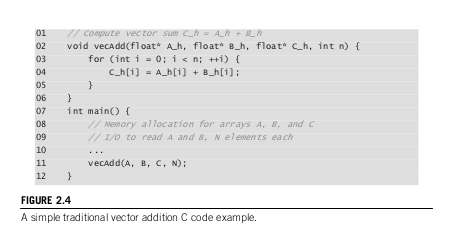
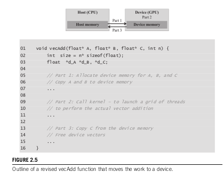

# 2.3 A Vector Addition Kernel

Vector addition represents the canonical introductory example of parallel programming. It illustrates pure **data parallelism**: two arrays ($A$ and $B$) are summed element-wise, storing results into array $C$.

---

## Part 1: The Traditional CPU Approach

**Compilation Note:** Even though this is standard, single-threaded C++ code executing entirely on the CPU host and saved as a `.cpp` file, it compiles directly via the NVIDIA compiler driver (`nvcc vector_addition.cpp && ./a.out`). Because CUDA C is an extension of C++, `nvcc` forwards native host code directly to the host compiler (`gcc`/`g++`).

The following diagram illustrates how a standard, single-threaded C program executes vector addition:



Below is the complete implementation ([vector_addition.cpp](./vector_addition.cpp)) corresponding to the execution flow above:

```c
#include <stdlib.h>
#include <stdio.h>

// Compute vector sum C_h = A_h + B_h
void vecAdd(float* A_h, float* B_h, float* C_h, int n) {
    for (int i = 0; i < n; ++i) {
        C_h[i] = A_h[i] + B_h[i];
    }
}

int main() {
    int N = 1000; // Example size
    
    // Memory allocation for arrays A, B, and C on the CPU (Heap Memory)
    float *A = (float*)malloc(N * sizeof(float));
    float *B = (float*)malloc(N * sizeof(float));
    float *C = (float*)malloc(N * sizeof(float));

    // Data initialization for A and B
    for(int i = 0; i < N; i++) {
        A[i] = 1.0f;
        B[i] = 2.0f;
    }

    // Invoke vector addition function
    vecAdd(A, B, C, N);

    // Release allocated heap memory
    free(A); free(B); free(C);
    
    return 0;
}
```

### Core Concepts: Pointers, Arrays, and Memory Semantics

1. **Definition of "Vector" in this Context:**  
   In this computational context, a "vector" denotes a standard 1D linear array of floating-point numbers allocated in memory, each containing $N$ elements. In C, dynamic arrays are allocated via `malloc`, returning a pointer to the initial element (index 0).

2. **Passing Pointers (`float* A_h`) vs. Value Semantics:**  
   Passing entire arrays by value incurs prohibitive memory copy overhead. If array $A$ contains 1,000,000 elements, pass-by-value would force the runtime to allocate and duplicate all 1,000,000 floats simply to invoke `vecAdd`. In C/C++, array names decay to pointers; passing the memory address of the first element ensures execution is lightweight and fast ($O(1)$ parameter passing).

3. **Pass-by-Reference Semantics:**  
   Passing pointer `C` into the `C_h` parameter provides `vecAdd` with the direct physical memory address of the array in system RAM. The statement `C_h[i] = A_h[i] + B_h[i];` dereferences this pointer, modifying the underlying buffer allocated in `main()`.

---

## Part 2: The GPU Outsourcing Approach

Modifying the host CPU function to offload arithmetic to the GPU yields the following structure:



Below is the complete implementation incorporating both host orchestrator and device kernel code:

```cuda
#include <cuda_runtime.h>
#include <math.h>

// ---------------------------------------------------------
// DEVICE CODE (Kernel executing on the GPU)
// ---------------------------------------------------------
__global__ void vecAddKernel(float* A, float* B, float* C, int n) {
    // Calculate global thread coordinate
    int i = blockIdx.x * blockDim.x + threadIdx.x;
    
    // Boundary condition check
    if (i < n) {
        C[i] = A[i] + B[i]; // Each thread executes one addition
    }
}

// ---------------------------------------------------------
// HOST CODE (Orchestrator executing on the CPU)
// ---------------------------------------------------------
void vecAdd(float* A, float* B, float* C, int n) {
    int size = n * sizeof(float);
    float *d_A, *d_B, *d_C; // 'd_' prefix denotes device (VRAM) pointer

    // Part 1: Allocate device memory in GPU VRAM
    cudaMalloc((void**)&d_A, size);
    cudaMalloc((void**)&d_B, size);
    cudaMalloc((void**)&d_C, size);

    // Transfer inputs A and B from CPU RAM to GPU VRAM
    cudaMemcpy(d_A, A, size, cudaMemcpyHostToDevice);
    cudaMemcpy(d_B, B, size, cudaMemcpyHostToDevice);

    // Part 2: Kernel launch configuration
    int threadsPerBlock = 256;
    int blocksPerGrid = (n + threadsPerBlock - 1) / threadsPerBlock; 
    
    // Launch kernel across the execution grid
    vecAddKernel<<<blocksPerGrid, threadsPerBlock>>>(d_A, d_B, d_C, n);

    // Part 3: Transfer result C from GPU VRAM back to CPU RAM
    cudaMemcpy(C, d_C, size, cudaMemcpyDeviceToHost);

    // Release allocated device memory
    cudaFree(d_A);
    cudaFree(d_B);
    cudaFree(d_C);
}
```

---

### Architectural Analysis: Transparent Outsourcing vs. Real-World Efficiency

1. **The Host Coordinator Pattern:**  
   The CPU `vecAdd` function performs no arithmetic directly. It operates as an orchestrator managing three hardware steps:
   * **Data Staging:** Copies arrays `A` and `B` from system RAM across the PCIe bus into GPU VRAM (`cudaMemcpyHostToDevice`).
   * **Kernel Dispatch:** Enqueues the parallel grid execution configuration (`vecAddKernel<<<...>>>`).
   * **Result Retrieval:** Copies computed output `C` from GPU VRAM back to system RAM (`cudaMemcpyDeviceToHost`).

2. **The "Transparent" Encapsulation Model:**  
   From the perspective of `main()`, invoking `vecAdd(A, B, C, N);` appears identical to invoking a standard C library function. The underlying GPU memory allocations, PCIe transfers, and kernel dispatch remain encapsulated inside `vecAdd`.

3. **PCIe Transfer Overhead in Naïve Pipelines:**  
   While this transparent pattern clarifies basic program structure, repeatedly allocating and transferring data across the PCIe bus for a single arithmetic operation introduces severe latency overhead. Copying data across the bus can consume 90%+ of total execution time if arithmetic intensity is low (e.g., performing a single floating-point addition per 8 bytes of transferred data).

4. **Production Architecture Practice:**  
   High-performance GPU pipelines minimize PCIe traffic by allocating device memory once at application startup, retaining data in VRAM, chaining multiple successive kernel executions on-device, and transferring results back to host memory only when the entire computational pipeline completes.
