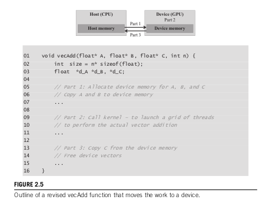
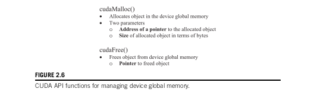
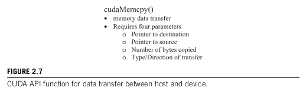
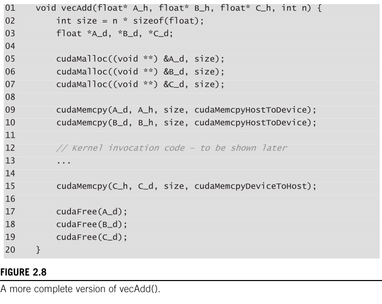

# 2.4 Device Global Memory and Data Transfer

### 1. Hardware Context: What is "Global" Memory?

In modern CUDA systems, the GPU devices are often physically separate hardware cards plugged into the motherboard (like an NVIDIA Volta V100, which comes with 16GB or 32GB of its own memory). Because these are discrete, separate cards, they come equipped with their own dedicated, onboard dynamic random-access memory (DRAM).

**Deep Dive: Why are devices "often" hardware cards?**
In High Performance Computing (HPC), GPUs are almost always discrete PCIe cards (like the V100, RTX 3090, etc.) with their own dedicated VRAM chips. However, the book specifically uses the word "often" because there is an alternative in the CUDA ecosystem: **Integrated Systems-on-a-Chip (SoCs)** (like the NVIDIA Jetson Nano or Tegra line). In these integrated setups, the CPU (ARM) and the GPU share the exact same physical RAM (Unified Memory). Even though there is no physical PCIe bus to cross in those integrated systems, the CUDA programming model still conceptually treats the memory spaces as separate to maintain compatibility across all hardware.

**Deep Dive: Why is Host-to-Device transfer considered a bottleneck?**
For discrete cards, moving data from the CPU RAM to the GPU VRAM is physically exhausting. The data must travel from the CPU RAM -> Memory Controller -> Motherboard Traces -> PCIe Slot -> across the PCIe Bus -> into the GPU PCIe Controller -> and finally into the GPU VRAM. The PCIe bus is extremely slow compared to the GPU's internal memory bandwidth. This physical distance is why `cudaMemcpy` calls must be minimized as much as possible.

In CUDA terminology, this massive pool of VRAM is called **Device Global Memory**, or simply **Global Memory**.

**Why call it "global"?**
Calling it "global" memory distinguishes it from other types of device memory that are also accessible. It is "global" because it acts as the main public square of the GPU—every single thread running across the entire GPU grid has full read and write access to this memory. Later chapters cover more restricted, specialized memory types (like Shared Memory or Constant Memory).

---

### 2. The Data Transfer Workflow

Before a GPU can actually perform any computation, data must be physically moved across the motherboard (via the PCIe bus) to the GPU, and answers brought back.

This decomposes into three sequential phases, matching the structure of the revised `vecAdd` function:



The workflow is exactly:

1. **Part 1 (Allocate & Copy):** Prior to kernel launch, device memory must be **allocated** in device global memory and input data **transferred** from the host memory (CPU RAM) to the allocated space in the device global memory.
2. **Part 2 (Compute):** Call the kernel to launch a grid of threads to perform the actual vector addition.
3. **Part 3 (Copy & Free):** Following device execution, output data is **transferred** from device global memory back to host memory, and device allocations are **released** in the device global memory that is no longer needed.

**A note on terminology:** From this point on, *"data transferred from host to device"* serves as shorthand for saying *"the data is copied from the host memory to the device global memory."*

---

### 3. API Functions: `cudaMalloc` and `cudaFree`

To perform these activities, the CUDA runtime system provides API functions. In Part 1 and 3, API functions allocate memory for vectors A, B, and C, transfer them back and forth, and finally free them.



There is a "striking similarity" between `cudaMalloc` and the standard C runtime library `malloc` function. This is highly intentional. CUDA C is just C with minimal extensions. By keeping the interface as close to the original C runtime libraries as possible, NVIDIA minimizes the time spent relearning how to manage memory.

#### The Sample Code

Here is the simple code example illustrating the use of these two functions:

```c
float *A_d;
int size = n * sizeof(float);
cudaMalloc((void**)&A_d, size);
...
cudaFree(A_d);
```

#### The Danger of Dereferencing Device Pointers

The addresses stored in `A_d`, `B_d`, and `C_d` point to physical locations in the **device global memory** (the GPU VRAM).

**CRITICAL RULE:** These addresses must **never** be dereferenced in the host code (the CPU code).
Device pointers must only be passed as arguments to CUDA API functions (like `cudaMemcpy`) or to kernel functions on the GPU. Attempting to dereference a device pointer in host CPU code causes a fatal segmentation fault because the CPU host cannot directly address physical GPU VRAM across the PCIe bus.

**Experiment: The Hidden CUDA Context Overhead**

Empirical evaluation via [`cuda_malloc_memcpy.cu`](./cuda_malloc_memcpy.cu) on an **RTX 3060 GPU** demonstrates baseline VRAM consumption:
First, an allocation of 1 million floats (4 MB of data) was evaluated:

```cpp
// Test 1: 1 Million Floats
int main() {
  float *A_d;
  int size = 1000000 * sizeof(float); // 4 MB
  cudaMalloc((void **)&A_d, size);
  std::cin.get(); // Pause to check nvidia-smi
  cudaFree(A_d);
}
```

When checking the GPU, this 4 MB allocation surprisingly consumed **108 MB** of VRAM.

Next, an allocation of 4 million floats (16 MB of data) was evaluated:

```cpp
// Test 2: 4 Million Floats
int main() {
  float *A_d;
  int size = 4000000 * sizeof(float); // 16 MB
  cudaMalloc((void **)&A_d, size);
  std::cin.get();
  cudaFree(A_d);
}
```

When checking the GPU, this 16 MB allocation consumed **120 MB** of VRAM.

**The Math & The Explanation:**

* Test 1: 108 MB (Total) - 4 MB (Allocated Array) = **104 MB Overhead**
* Test 2: 120 MB (Total) - 16 MB (Allocated Array) = **104 MB Overhead**

so, the remaining 104 MB is a constant overhead known as the **CUDA Context**. The very first time a program calls a CUDA API function (like `cudaMalloc`), the CUDA runtime must initialize itself on the device. This involves allocating memory for page tables, device-side runtime structures, and module loading. This context creation is a mandatory, one-time "flat fee" of roughly ~100 MB per process.

---

## 4. The Complete `cudaMalloc` and Pointers Deep Dive

Analyzing memory allocation mechanics reveals distinct behavior across memory allocators:

### Question: How does `new` in C++ handle allocation?

**Answer:** When writing `float *A = new float[10];`, C++ does two things automatically:

1. It looks at the type (`float`) and knows it is 4 bytes.
2. It multiplies that by 10 elements to get 40 bytes.
It allocates exactly 40 bytes and returns a typed `float*` pointer. **With C++ `new`, 1 unit = 1 element.**

* **The Critical Trap: `new int[1000]` vs `new int(1000)` vs `new 1000`:**
  * **`new int[1000]` (Square Brackets `[]`):** Allocates an **array of 1000 integers** (4,000 bytes on heap). Uninitialized elements. Must be deallocated with `delete[] A;`.
  * **`new int(1000)` (Parentheses `()`):** Allocates **ONLY ONE integer** (4 bytes), and initializes its value to 1000 (`*B == 1000`). It is NOT an array! Must be deallocated with `delete B;`.
  * **`new 1000` (No type):** **Compile error!** `new` requires a data type, not a number literal.

| Syntax | What It Allocates | Memory Allocated | Meaning of `1000` | Deallocation |
| :--- | :--- | :--- | :--- | :--- |
| `new int[1000]` | Array of 1000 ints | **4,000 bytes** | Number of elements | `delete[] ptr;` |
| `new int(1000)` | Single int | **4 bytes** | Stored value (`1000`) | `delete ptr;` |
| `new 1000` | **Syntax Error** | 0 bytes | Invalid | N/A |
| `malloc(1000)` | Raw bytes | **1,000 bytes** | Byte count | `free(ptr);` |
| `cudaMalloc(&d, 1000)` | Raw bytes on GPU | **1,000 bytes** | Byte count | `cudaFree(d);` |

### Question: How does `malloc` in C handle allocation?

**Answer:** When writing `float *A = (float*)malloc(40);`:

* `malloc` has no idea what data type is being stored. It strictly deals in **raw bytes**. **1 unit = 1 raw byte.** (For example, 10 int32s is exactly 40 bytes).
* Returns a `void*` (a generic untyped memory address, leaving type interpretation to the caller).
* **The C vs C++ difference:** In pure C, `malloc` does NOT need a cast; a `void*` automatically flows into a `float*`. However, in C++, the compiler's strict type-checking forbids this, forcing the `(float*)` cast explicitly.

### Question: How does `cudaMalloc` handle allocation compared to `malloc`?

**Answer:** Both `malloc` and `cudaMalloc` deal in **raw bytes** (`size = n * sizeof(float)`). However, their delivery mechanism is fundamentally different:

* **`malloc` RETURNS the pointer directly:** It computes the address and returns it as a value (`A = malloc(...)`).
* **`cudaMalloc` WRITES the pointer into a variable:** It uses its return value strictly for error codes (like `cudaSuccess`). Because it cannot return the address, a "delivery address" (`&A_d`) must be provided, and it writes the GPU VRAM address directly into that variable.
* **The `devPtr` Parameter vs `&A_d` Calling Syntax:**
  * Signature: `cudaError_t cudaMalloc(void** devPtr, size_t size);`
  * The parameter `devPtr` is of type `void**` (address of a pointer).
  * In the caller code: `float* A_d; cudaMalloc((void**)&A_d, size);`
  * When called, `&A_d` is passed as the `devPtr` argument. Inside `cudaMalloc`, it performs `*devPtr = allocated_vram_address;`, which dereferences `devPtr` once and writes the 64-bit GPU address straight into the stack variable `A_d`.

### Question: What exactly is a pointer at the hardware level?

**Answer:** A pointer is nothing but an 8-byte box (on a 64-bit system) containing a number (a memory address).

* **Casting does NOT change bits:** A C script proves that a `void*` and a `float*` are exactly the same size (8 bytes).
* Casting a pointer from `void*` to `float*` does not physically alter the memory address. The type is purely an instruction to the compiler to define the **hop size** for pointer arithmetic. A `float*` tells the compiler to hop 4 bytes at a time; a `void*` throws an error because the hop size is unknown.

<a id="question-address-of-dereferencing"></a>

### Question: How do the Address-Of (`&`) and Dereferencing (`*`) operators work, and what is legal vs. illegal?

**Answer:** As documented in [Appendix C — Checking Pointer Expressions: What is Legal vs Illegal?](../../CUDA_for_Engineers/Appendix_C_Need_to_Know_C_Programming/Characterization_of_C.md#checking-pointer-expressions-what-is-legal-vs-illegal), the address-of operator `&` evaluates to an **rvalue** (a temporary memory address coordinate).

| Operation | Code | Status | Meaning at Hardware Level |
| :--- | :--- | :--- | :--- |
| **Address-of** | `p = &x;` | ✅ Legal | Asks the compiler for the memory address of the variable `x` and stores that address into `p`. |
| **Assigning to an address** | `&x = p;` | ❌ **Illegal** | `&x` is a read-only memory coordinate (an rvalue). Direct assignment to an address literal is invalid. |
| **Dereferencing** | `*p = 5;` | ✅ Legal | *"Go to the memory address stored in `p` and write the value 5 there."* |
| **Roundabout dereferencing** | `*(&x) = 5;` | ✅ Legal | Gets the address of `x` and immediately dereferences it. Equivalent to writing `x = 5`. |
| **Dereferencing a non-pointer** | `*x = 5;` | ❌ **Illegal** | `x` is a raw int, not a pointer. The computer would attempt to write to memory address `0x00000005` (restricted address), crashing or failing compilation. |

#### How This Connects Directly to CUDA

1. **The Core Mystery: "If `&A_d` is a read-only address, how can `cudaMalloc` write to it?"**
* Writing `&A_d = ...;` is ❌ **ILLEGAL** because `&A_d` is an rvalue (the physical address of the CPU pointer variable). Stack coordinates are immutable at runtime.
   * BUT `cudaMalloc` does **NOT** write to `&A_d` directly! It **dereferences** the address:

     ```c
     *devPtr = allocated_gpu_vram;   // ✅ 100% LEGAL!
     ```

* Invoking `cudaMalloc((void**)&A_d, size)` passes `&A_d` to parameter `devPtr`. Inside `cudaMalloc`, executing `*devPtr = allocated_gpu_memory;` writes the address into `A_d`.
   * Inside `cudaMalloc`, the code does `*devPtr = ...`. Dereferencing `*devPtr` tells the CPU: *"Go to the memory address stored in `devPtr` (the `A_d` box on the CPU stack) and write the new GPU address INSIDE that box!"*

2. **The CPU Stack Lifecycle of `A_d`:**

   ```text
   Step 1: Declaration on CPU Stack
   float* A_d = nullptr;
   --------------------------------------------------------------
   Stack Address       Variable Name       Value Inside Box
     0x7FFF0040            A_d             0x0 (nullptr)
   --------------------------------------------------------------

   Step 2: Calling cudaMalloc((void**)&A_d, 4000)
   - &A_d evaluates to 0x7FFF0040 (the stack coordinate).
   - devPtr inside cudaMalloc receives 0x7FFF0040.
   - GPU allocates 4000 bytes at GPU VRAM address 0x70001000.

   Step 3: cudaMalloc writes via dereference: *devPtr = 0x70001000;
   --------------------------------------------------------------
   Stack Address       Variable Name       Value Inside Box
     0x7FFF0040            A_d             0x70001000 (GPU VRAM Address!)
   --------------------------------------------------------------
   ```

3. **Comparison: Printing `A_d` vs. `*(&A_d)` vs. `*A_d`**

   | Expression | Where run | What it does | Result / Output |
   | :--- | :--- | :--- | :--- |
   | `A_d` | **CPU** (`main`) | Reads the value inside the CPU stack box `A_d` | ✅ Prints GPU hex address (e.g. `0x70001000`) |
   | `*(&A_d)` | **CPU** (`main`) | `&` gets address of `A_d` box, `*` opens it ($*(\&A\_d) \equiv A\_d$) | ✅ Prints exact same GPU hex address (`0x70001000`) |
   | `*A_d` | **CPU** (`main`) | CPU tries to reach across PCIe into GPU DRAM to read float | ❌ **Segmentation fault (CRASH!)** |
   | `A_d` | **GPU** (`kernel`) | Thread reads the pointer argument | ✅ Prints GPU hex address (`0x70001000`) |
   | `*A_d` | **GPU** (`kernel`) | GPU thread reads float from its own local VRAM | ✅ Prints actual float value (`0.000000`) |

   > **Crucial Rule:** `A_d` and `*(&A_d)` are mathematically and semantically identical in C and C++. Both inspect the **CPU stack box** and safely print the address stored inside. Only raw `*A_d` (without `&`) attempts to dereference the GPU memory address, which crashes if done on the CPU!

4. **All 64-Bit Pointers Occupy 8 Bytes Regardless of Datatype:**
   At the hardware level, every pointer on a 64-bit architecture is strictly an **8-byte box** holding a 64-bit address:

   ```cpp
   sizeof(char*)    == 8 bytes
   sizeof(int*)     == 8 bytes
   sizeof(float*)   == 8 bytes
   sizeof(double*)  == 8 bytes
   sizeof(void*)    == 8 bytes
   sizeof(float**)  == 8 bytes
   ```

   * The **datatype** attached to the pointer (`float*`) does not change the physical size of the box (always 8 bytes).
   * It only tells the compiler how many bytes to read when dereferencing (`sizeof(float) = 4` bytes) and how many bytes to jump during pointer arithmetic (`+4` bytes).
   * Calling `typeid(A_d).name()` reflects its compile-time declared type (`float*`), and the temporary `(void**)` cast in `cudaMalloc` has zero permanent effect on `typeid(A_d)`.

---

<a id="question-pointer-arithmetic-hop-size"></a>

### Question: How does pointer arithmetic work, and what is the "hop size" rule?

**Answer:** In C and C++, pointer arithmetic does **not** advance by raw single bytes; it automatically advances by **the size of the data type being pointed to** (the "hop size"):

$$\text{Address after } (ptr + i) = \text{base address} + (i \times \text{sizeof}(*ptr))$$

#### The Fundamental Equivalence: Array Indexing is Pointer Arithmetic

In C and CUDA, array bracket notation is literally syntactic sugar for pointer arithmetic and dereferencing:

$$\text{Array Indexing: } A[i] \iff *(A + i)$$

```c
float* A;
A[0]  ==  *(A + 0)   // Address: base + (0 × 4) = base + 0 bytes
A[1]  ==  *(A + 1)   // Address: base + (1 × 4) = base + 4 bytes
A[2]  ==  *(A + 2)   // Address: base + (2 × 4) = base + 8 bytes
A[i]  ==  *(A + i)   // Address: base + (i × 4) = base + 4*i bytes
```

#### Hop Size Comparison Table

| Pointer Type | `sizeof(*ptr)` | What `ptr + 1` does | Bytes Moved | Can do Arithmetic? |
| :--- | :--- | :--- | :--- | :--- |
| `char*` | 1 byte | Moves to the next byte | **+1 byte** | ✅ Yes |
| `int*` | 4 bytes | Skips 1 whole integer | **+4 bytes** | ✅ Yes |
| `float*` | 4 bytes | Skips 1 whole float | **+4 bytes** | ✅ Yes |
| `double*` | 8 bytes | Skips 1 whole double | **+8 bytes** | ✅ Yes |
| `void*` | **Unknown** | Undefined hop size | **Error** | ❌ **No! Compiler error!** |

> **Why `void*` arithmetic is forbidden:** Because `void` has no defined size (`sizeof(void)` is meaningless in standard C++). The compiler doesn't know whether `ptr + 1` should advance by 1, 4, 8, or 100 bytes! This is why `cudaMalloc`'s `void*` is only for generic transport — before doing math or kernel indexing, pointers must always have a concrete type like `float*` or `int*`.

#### How CUDA Kernels Use Pointer Arithmetic Every Day

When each GPU thread runs:

```c
int i = blockDim.x * blockIdx.x + threadIdx.x;
if (i < n) {
    C_d[i] = A_d[i] + B_d[i];
}
```

Under the hood, the hardware executes pointer arithmetic:
* It takes the base address of `A_d` and adds `i × 4` bytes.
* It takes the base address of `B_d` and adds `i × 4` bytes.
* It adds the numbers and writes the result to `C_d` at base address `C_d + (i × 4)`.

---

### Question: Why does `cudaMalloc` require a `(void**)` cast?

**Answer:** The `cudaMalloc` function signature expects a generic pointer `void**` because it is a generic function not restricted to any particular type of object.

* **Is `&A_d` a secret pointer created by the OS?**
**No.** The compiler does not create a separate pointer variable in memory to hold the address.
* **Is it void by default?**
  **No.** Using `typeid()` proves that the C++ compiler strictly evaluates `&A_d` as a `float**`. It is never a `void` by default. It perfectly inherits the type of the variable it points to.
* **Why must it be cast?**
  Because C does not have Function Overloading or Templates. NVIDIA had to write exactly one generic function: `cudaMalloc(void **devPtr, size_t size)`.
* If a `float**` is passed directly, the strict C++ compiler throws a fatal type mismatch error.
* The `(void**)` cast is a **temporary permission slip**. It tells the compiler to temporarily treat the coordinates of the float pointer as generic coordinates, just to bypass the strict function signature.

### Question: How can a `void` pointer address be written into a `float` pointer variable?

**Answer:** At the hardware level, all pointers are just 8-byte numbers. When `cudaMalloc` executes, it generates an 8-byte GPU VRAM address. It goes to the delivery address provided (`&A_d`) and shoves those 8 bytes into the 8-byte box belonging to `A_d`.
Because both a generic pointer and a float pointer are physically identical 8-byte boxes, it fits perfectly. There is no internal conversion needed because, to the hardware, a pointer is just a raw number regardless of its C++ type label.

### Question: What does `malloc` literally return?

**Answer:** It literally just returns a raw 64-bit memory address (a number like `0x7FFF1000`).
When writing `A_d = (float*)malloc(...)`, there is no "temporary pointer variable" created. The CPU just calculates the raw hex address, and directly assigns that numeric value into the `A_d` variable.

### Question: Does the `(void**)` cast in `cudaMalloc` permanently change the pointer's type globally?

**Answer:** When writing `(void**)&A_d` inside the `cudaMalloc` call, the cast is strictly **local** to that single line of code. It simply acts as a temporary disguise so the function accepts it. Once `cudaMalloc` finishes executing, the compiler rips off the disguise. Everywhere else in the code (globally), `A_d` remains a strictly-enforced `float*` pointer.

### Question: When Creating a Pointer, Does the OS Automatically Allocate Storage for the Value?

**Answer:** **A pointer does NOT contain another pointer.** A pointer is just a single variable on the stack (a box).
When using the `&` operator (e.g., `&A_d`), the computer does **not** create a new "pointer inside a pointer" to hold the address. The `&` operator is just a mathematical question to the compiler: *"What is the stack coordinate of this box?"* The compiler simply calculates the coordinate and hands it to `cudaMalloc`. No extra variables are created by the programmer or the OS.

### Question: Why is dynamically allocating multidimensional arrays with `cudaMalloc` so complex?

**Answer:** The fact that `cudaMalloc` returns a generic object makes the use of dynamically allocated multidimensional arrays more complex.

* **Explanation:** In C, a 2D array is created as an array of row-pointers (a pointer to pointers). Trying to build this structure across the PCIe bus with `cudaMalloc` is a nightmare. It requires allocating an array of row-pointers on the GPU, allocating individual rows on the GPU, temporarily storing the GPU row-pointers in a CPU array, and using a complex `cudaMemcpy` to send that array over to the GPU.
* **The Practical Fix:** Because `cudaMalloc` uses raw generic memory, CUDA programmers almost always avoid 2D pointers. Instead, a 2D matrix is flattened into a 1D array (`float *d_matrix; cudaMalloc(&d_matrix, ROWS * COLS * sizeof(float));`) and the indices are calculated manually using `row * NUM_COLS + col`.

---

### 5. API Function For Memory Transfer : `cudaMemcpy`

Once the host code has allocated space in the device global memory using `cudaMalloc`, it can request that data be transferred across the PCIe bus. This is accomplished using the `cudaMemcpy` function.



The `cudaMemcpy` function strictly requires four parameters:

1. **Pointer to Destination:** The memory address where the data will be written.
2. **Pointer to Source:** The memory address where the data is currently located.
3. **Number of Bytes:** The total size of the payload being copied.
4. **Direction of Transfer:** A constant indicating the type of memory involved (e.g., `cudaMemcpyHostToDevice`, `cudaMemcpyDeviceToHost`, `cudaMemcpyDeviceToDevice`, or `cudaMemcpyHostToHost`).



#### The Code Implementation

Below is the code sequence for executing data transfers via `cudaMemcpy` (from [`cuda_malloc_memcpy.cu`](./cuda_malloc_memcpy.cu)):

```cpp
  // Test 3 : cudaMemcpy
  // int size = 1000000 * sizeof(float); //~4 MiB (or) 1 million floats ,,, ,
  //using new instead of malloc ,,, , 
    // float* A_h=new float[1000000];
   // setting all to 1 ,,, , 
//     float *A_h = (float *)malloc(size);
//   for (int i = 0; i < 1000000; ++i) {
//     A_h[i] = 1.0f;
//   }
  //  using 4 million floats
  int size = 4000000 * sizeof(float); //~16Mib (or) 4 million floats ,,, ,

  float *A_h = (float *)malloc(size);
  for (int i = 0; i < 4000000; ++i) {
    A_h[i] = 1.0f;
  }
  std::cout << "[";
// Initialized A_h with 1.0f
  //  so lets see whether it will take as 1.0f natively or not ,
  // by printing the values ,
  // should print 1.0 's    ,,, ,
  for (int i = 0; i < 100; ++i) {
    std::cout << A_h[i] << " ";
  }
  std::cout << "]\n";

  // allocate same space in gpu vram before doing cudaMemcpy ,,, ,
  float *A_d;
  cudaMalloc((void **)&A_d, size);

  // right after creating this would be garbage. To print and see the
  // values/memory in gpu:
  // 1) From the CPU (main function): first , need to cudaMemcpy it back to a
  // CPU array and use std::cout as the CPU cannot read VRAM directly , 2) From
  // the GPU : CUDA actually has a built-in printf() , but can be used inside a
  // __global__ kernel , it can print the VRAM data directly to the terminal ,
  float *B_h = (float *)malloc(size);
  cudaMemcpy(B_h, A_d, size, cudaMemcpyDeviceToHost);
  // should print some garbage or luckily zeroes     ,,, ,
  std::cout << "[";
  for (int i = 0; i < 100; ++i) {
    std::cout << B_h[i] << " ";
  }
  std::cout << "]\n";

  // now lets transfer A_h data (already filled with 1) using cudaMemcpy
  cudaMemcpy(A_d, A_h, size, cudaMemcpyHostToDevice);
  // now lets print the values in A_h by printing thosevalues transferrign to
  // cpu should print 1.0 's    ,,, ,
  float *C_h = (float *)malloc(size);
  cudaMemcpy(C_h, A_d, size, cudaMemcpyDeviceToHost);
  std::cout << "[";
  for (int i = 0; i < 100; ++i) {
    std::cout << C_h[i] << " ";
  }
  std::cout << "]\n";

  std::cin.get();
  cudaFree(A_d);
  free(A_h);
  free(B_h);
  free(C_h);
  std::cin.get();
```

**Observation: The CPU-Side CUDA Context "Tax"**

Tracking memory during execution via Linux `htop` illustrates host memory behavior:

* **First Pause (`std::cin.get();` before `free`):** Execution pauses prior to calling `cudaFree` or CPU `free`, allowing inspection of peak RAM via `htop` and VRAM via `nvidia-smi`.
* **Second Pause (`std::cin.get();` after `free`):** After pressing Enter, the program proceeds to execute the `free()` and `cudaFree()` commands, destroying the arrays. The program then hits the second pause. The purpose of this pause is to see what memory remains after all custom arrays are destroyed.

Executing this code sequence across two test configurations reveals:

1. **Test 1 (1 Million Floats):** Execution with 1 million floats (4 MB per array):
* **At First Pause:** `htop` reported peak host RAM consumption of **~108.6 MB**.
* **At Second Pause:** Memory deallocation immediately dropped host memory usage to baseline.
    * **The Math:** `108.6 MB (Total)` - `12 MB (Destroyed Arrays)` = `~96.6 MB (Remaining)`.

2. **Test 2 (4 Million Floats):** Execution with 4 million floats (16 MB per array):
    * **At First Pause:** `htop` reported a peak of **~144.7 MB** of RAM!
* **At Second Pause:** Deallocation immediately returned host memory to baseline.
    * **The Math:** `144.7 MB (Total)` - `48 MB (Destroyed Arrays)` = `~96.7 MB (Remaining)`.

As established in Section 3, GPU initialization incurs a ~104 MB baseline CUDA context overhead in VRAM.

The official [NVIDIA CUDA Driver API documentation for cuCtxCreate](https://docs.nvidia.com/cuda/cuda-driver-api/group__CUDA__CTX.html) defines that a CUDA context encapsulates all resources (modules, streams, memory allocations) for a process on the GPU. The [NVIDIA MPS documentation](https://docs.nvidia.com/deploy/mps/index.html) further states: *"each CUDA process using a GPU allocates separate storage and scheduling resources on the GPU."*

**Important Note:** NVIDIA does not publish a static byte size for context overhead; empirical measurement of **~104 MB** on an RTX 3060 (Ampere) under Linux serves as a practical reference.

### Question: Why does `cudaMemcpy` have a `HostToHost` option when standard C `memcpy` already exists?

**Answer:** The book states the fourth parameter of `cudaMemcpy` can be `cudaMemcpyHostToHost`. It seems redundant to have this when the standard C library already provides `memcpy()`. However, it exists for two critical reasons:

1. **API Uniformity (Avoiding messy If-Statements):** "Uniformity" means the API behaves exactly the same way no matter what the situation is.
   Imagine building a large framework (like PyTorch) where a user can dynamically move data around. If `cudaMemcpyHostToHost` did **not** exist, the framework code would be forced to use messy `if/else` logic to handle the CPU-to-CPU edge case:

   ```cpp
   if (dest == CPU && source == CPU) {
       memcpy(dest, src, size); // Forced to switch to standard C library
   } else {
       cudaMemcpy(dest, src, size, kind); // Use CUDA for the rest
   }
   ```

   Because NVIDIA *did* include `HostToHost`, programmers don't have to write special exceptions. They can use one single, clean API call `cudaMemcpy(dest, src, size, kind)` that successfully handles **every possible combination** of data movement.
2. **Advanced Async Workflows:** Is it slower than normal C? No. NVIDIA's driver recognizes it is a host-to-host transfer and simply routes it to a highly optimized CPU memory copy routine (often identical to or faster than the standard C library using AVX/SIMD instructions). More importantly, later on, when using asynchronous streams (`cudaMemcpyAsync`) with "pinned" (page-locked) host memory, having a Host-to-Host option allows the CPU to queue up memory copies into CUDA Streams. This potentially offloads the copy work to DMA engines, allowing the CPU to do other things while the copy happens in the background.

---

### 6. Error Checking and Handling in CUDA

In practice, it is important to check and handle errors from CUDA API calls. Every CUDA API function (`cudaMalloc`, `cudaMemcpy`, `cudaFree`, etc.) returns a value of type `cudaError_t`. Most errors are due to inappropriate argument values used in the call.

#### What is `cudaError_t`?

`cudaError_t` is **not** a class. It is a `typedef` for an `enum` — a data type that is just a fancy name for an integer that can only hold specific predefined values. It is defined inside `cuda_runtime.h` by NVIDIA, something like:

```c
typedef enum {
    cudaSuccess                  = 0,
    cudaErrorInvalidValue        = 1,
    cudaErrorMemoryAllocation    = 2,
    cudaErrorInitializationError = 3,
    // ... roughly 80-100+ more entries depending on CUDA toolkit version
    cudaErrorUnknown             = 999,
} cudaError_t;
```

There are no constructors, no objects, no initialization needed. It is literally just an integer with named values.

#### Every CUDA API Function Returns `cudaError_t`

The actual function signature of `cudaMalloc` is:

```c
cudaError_t cudaMalloc(void **devPtr, size_t size);
```

The `cudaError_t` prefix denotes the **return type**. `cudaMalloc` operates as a function returning an error enumeration status code.

Runtime API functions like `cudaMalloc`, `cudaMemcpy`, and `cudaFree` can be invoked sequentially throughout the host program lifecycle.

#### Understanding Function Return Values vs Side Effects

Every function in C/C++ has two separate things:

1. **The task/job it does (side effect):** The actual work happening inside the function. It just happens.
2. **The return value:** A piece of data the function hands back to the caller after finishing its job.

For example, `printf` actually returns an `int` (the number of characters it printed):

```c
int a = printf("hello");
printf("%d", a);
// Output: hello5
// "hello" is the task (side effect — printing to screen)
// 5 is the return value (it printed 5 characters)
```

This was verified empirically in [`cudaError_t.cu`](./cudaError_t.cu).

The same logic applies to `cudaMalloc`:

* **Task (side effect):** Goes to the GPU, carves out VRAM, writes the address into the pointer variable.
* **Return value:** An enum number (`0` for success, `2` for out of memory, etc.).

C/C++ syntax permits discarding function return values, allowing API calls to execute without explicit error assignment.

Similarly, `int main()` returns an `int` to the operating system. After a program finishes, the shell stores it in the special variable `$?`:

```bash
./a.out
echo $?    # Prints the return value of main (0 = success)
```

Verification via terminal execution confirmed `echo $?` returned `0` upon completion.

#### The Error Checking Pattern (Fig 2.9)

The book provides the standard error checking pattern:

```c
cudaError_t err = cudaMalloc((void**)&A_d, size);
if (err != cudaSuccess) {
    printf("%s in %s at line %d\n", cudaGetErrorString(err),
           __FILE__, __LINE__);
    exit(EXIT_FAILURE);
}
```

Breaking this down:

* `cudaGetErrorString(err)` — Takes the raw enum number (like `2`) and returns a human-readable string (like `"out of memory"`). Without this function, the error number alone is useless to a human.
* `cudaGetErrorName(err)` — A related function that returns the enum NAME itself (like `"cudaErrorMemoryAllocation"`) instead of the description.
* `__FILE__` — A C preprocessor macro that automatically inserts the current source filename as a string at compile time.
* `__LINE__` — A C preprocessor macro that automatically inserts the current line number as an integer at compile time.
* Together, `__FILE__` and `__LINE__` pinpoint exactly where the error happened in the codebase, saving hours of debugging.

#### Key Error Codes

| Number | Enum Name | Meaning |
| -------- | ----------- | --------- |
| 0 | `cudaSuccess` | No error, everything worked |
| 1 | `cudaErrorInvalidValue` | Bad argument (NULL pointer, negative size) |
| 2 | `cudaErrorMemoryAllocation` | `cudaMalloc` failed (out of VRAM) |
| 3 | `cudaErrorInitializationError` | Driver/runtime couldn't initialize |
| 77 | `cudaErrorIllegalAddress` | Kernel accessed invalid memory |
| 999 | `cudaErrorUnknown` | Unknown error |

#### Pointer Mechanics and `nullptr` Traps

Testing `cudaError_t` in [cudaError_t.cu](./cudaError_t.cu) reveals several important details regarding pointer formatting and initialization:

**Question: Is `float* A_d`, `float *A_d`, or `float * A_d` the correct official notation? Are they different?**
**Answer:** Both forms are syntactically identical; the compiler treats whitespace as neutral.

* `float *A_d` : Traditional C-style (preferred by Kernighan & Ritchie and NVIDIA's official docs).
* `float* A_d` : C++ style (reading as "A_d is of type float-pointer").
* `float * A_d` : Spaces on both sides (perfectly valid, whitespace is ignored).
* `float*A_d` : No spaces at all (perfectly valid, whitespace is ignored).

The only trap is declaring multiple variables on one line: `float* A_d, B_d;` makes `A_d` a pointer but `B_d` a regular float. `float *A_d, *B_d;` makes both pointers.
**Question: Does defining `float* A_d;` default to a null pointer?**
**Answer:** **NO!** This is extremely dangerous. An uninitialized pointer (`float* A_d;`) contains random GARBAGE addresses (whatever was previously sitting in that physical RAM location). It is NOT automatically null. It must be explicitly initialized using `float* A_d = nullptr;` (or `= NULL;` in older C) to actually be a null pointer (address `0x0`).

**Question: Can an initialized `nullptr` variable be passed to `cudaMalloc` or `cudaMemcpy`?**
**Answer:**

* **Passing to `cudaMalloc` (SAFE):** Passing a null pointer to `cudaMalloc((void**)&A_d, size)` is perfectly safe and actually good practice. `cudaMalloc` does not care what value was in `A_d` before; it strictly **overwrites** that variable with the newly allocated GPU address. Experiment 1 in [cudaError_t.cu](./cudaError_t.cu) demonstrates this returns `cudaSuccess` ("no error").
* **Passing to `cudaMemcpy` (FATAL):** Passing a null pointer as source or destination in `cudaMemcpy` triggers immediate runtime error 1 (`cudaErrorInvalidValue`).

**Question: What exactly are preprocessor macros? Do they exist in all languages like Python?**
**Answer:** `__FILE__` and `__LINE__` are strictly **C/C++ Preprocessor Macros**.

* **The Preprocessor:** Before C/C++ code is compiled into machine code, it goes through a "Text Replacement Phase" called the Preprocessor. When it sees `__FILE__` and `__LINE__`, it aggressively finds and replaces those words with the actual filename string and line number integer *before* the compiler even sees the code. It literally text-replaces it to `"cudaError_t.cu"` and `16`.
* **Compile-time vs Run-time:** Because this replacement happens before compilation, it has absolutely zero performance cost at run-time. The number `16` is permanently baked into the binary.
* **Other Languages (Python):** Python does **NOT** have a preprocessor because it is an interpreted language, not compiled. To get the current line number in Python, macros are unavailable; code must query runtime frames (e.g., using `inspect.currentframe().f_lineno`), which runs slower than a compile-time macro.

**Question: What does `exit(EXIT_FAILURE)` do in the book's error-checking code?**
**Answer:** `exit()` is a C standard library function (from `<stdlib.h>` or `<cstdlib>`) that instantly **terminates the entire program**, no matter where it is called.

* Unlike `return`, which only exits the current function it is inside, `exit()` kills the whole process immediately. **Calling `exit()` stops the program immediately. All following code is skipped: no waiting for user input like `std::cin.get()`, and no cleanup calls like `cudaFree()`. The program shuts down instantly.**
* `EXIT_FAILURE` is just a standard C macro defined as the integer `1`. (Similarly, `EXIT_SUCCESS` is defined as `0`).
* Calling `exit(EXIT_FAILURE)` is identical to calling `exit(1)`. It tells the Operating System that the program intentionally crashed or failed. In bash, `echo $?` prints `1`. This ensures that if `cudaMalloc` fails, the program aborts immediately rather than continuing with an invalid GPU state.

**Question: Is `EXIT_FAILURE` an enum or macro? What occurs if `#include <stdlib.h>` is omitted?**
**Answer:** Technically, it is **not an enum**; it is a **Preprocessor Macro**.

* Inside the standard C library, it is literally defined as `#define EXIT_FAILURE 1`. The preprocessor silently replaces `EXIT_FAILURE` with `1` purely for human readability, making it explicitly clear that the program is shutting down due to a failure.
* If `<stdlib.h>` (or `<cstdlib>`) is omitted, the compiler should report `exit()` or `EXIT_FAILURE` as undefined.
* **Header Inclusion Nuance:** In [`cudaError_t.cu`](./cudaError_t.cu), `exit(EXIT_FAILURE);` compiles even with `#include <stdlib.h>` commented out because `<iostream>` transitively includes `<cstdlib>` under glibc. Explicit inclusion remains necessary for portability across compilers.

**Question: How can an Out of Memory error be triggered to see `cudaErrorMemoryAllocation` (Error 2) in action?**
**Answer:** Yes. In Experiment 3 of [`cudaError_t.cu`](./cudaError_t.cu), allocating an excessive buffer size simulates this error:
Compilation and execution via the terminal:

```bash
nvcc "PMPP(programming massively parallel processors)/2.Heterogeneous_data_parallel_computing/cudaError_t.cu" && ./a.out
```

```cpp
long size1 = 1e15; // 1 Petabyte!
float *C_d = nullptr;
cudaError_t err2 = cudaMalloc((void **)&C_d, size1);
```

Because the RTX 3060 only has ~12 GB of VRAM, the driver immediately rejects the request. The function successfully returned `cudaErrorMemoryAllocation` (error code 2), and running it through `cudaGetErrorString(err2)` beautifully printed exactly `"out of memory"` to the terminal. This proves the error-handling API works precisely as designed for both logic bugs (like passing null pointers to `cudaMemcpy`) and hardware limitations.

**Question: If `cudaMalloc` fails, should `cudaFree(C_d)` still be invoked?**
**Answer:** No, it is not needed. Because `cudaMalloc` failed (e.g. out of memory), it never allocated any VRAM on the GPU. The CPU stack variable `C_d` is still exactly what it was initialized as: `nullptr`. Furthermore, when `main()` ends, the CPU automatically destroys the `C_d` stack variable. `cudaFree` is only meant for destroying data on the **GPU Heap**.

* **Behavior when calling `cudaFree(C_d)`:** If `C_d` is initialized to `nullptr`, `cudaFree(nullptr)` is a safe no-op returning `cudaSuccess`. If uninitialized, `cudaFree` faults on the garbage address.

**Question: What if `C_d` was not initialized to `nullptr` (just `float *C_d;`), `cudaMalloc` failed, and `cudaFree(C_d)` is called? Does this cause a Double Free or Dangling Pointer bug?**
**Answer:** Neither. This causes an **"Invalid Free"** bug (which CUDA reports as `cudaErrorInvalidDevicePointer`, Error Code 17).
Here is the strict breakdown of these pointer bugs:

1. **Invalid Free:** An uninitialized pointer holds indeterminate stack garbage. Freeing it faults because the memory manager cannot resolve the invalid address.
2. **Double Free:** Freeing the exact same valid pointer twice (e.g., `cudaFree(A_d); cudaFree(A_d);`).
3. **Dangling Pointer:** Using a pointer to read or write data after freeing it (e.g., `cudaFree(A_d); cudaMemcpy(A_d, ...);`).
This proves exactly why initializing every pointer with `= nullptr;` is a mandatory safety practice.

**Experiment 5: The Secret NVIDIA Safety Net**
Investigating this behavior with [`test_free.cu`](./test_free.cu) demonstrates runtime allocator handling:

Here is the complete, untrimmed code for the experiment:

```cpp
#include <cuda_runtime.h>
#include <iostream>

int main() {
    float *C_d;
    // Let's set it to a known garbage value
    C_d = (float*)0xDEADBEEF;
    std::cout << "Before cudaMalloc: " << C_d << std::endl;
    
    cudaError_t err = cudaMalloc((void**)&C_d, 1e15);
    std::cout << "cudaMalloc error: " << cudaGetErrorString(err) << std::endl;
    std::cout << "After cudaMalloc: " << C_d << std::endl;
    
    cudaError_t err2 = cudaFree(C_d);
    std::cout << "cudaFree error: " << cudaGetErrorString(err2) << std::endl;
    return 0;
}
```

To run this experiment:

```bash
nvcc test_free.cu && ./a.out
```

**Deep Analysis of the Experiment:**

1. **Assigning a sentinel garbage pointer (`C_d = (float*)0xDEADBEEF;`):** Intentionally points `C_d` to an invalid address.
2. **Simulating allocation failure (`cudaMalloc`):** Requesting an impossible allocation forces `cudaErrorMemoryAllocation`.
3. **The Result (Printing `C_d` after failure):** Printing the pointer *after* the failed `cudaMalloc` no longer shows `0xdeadbeef`. It shows `0` (which is `nullptr`).

**Conclusion:** When `cudaMalloc` fails, it guarantees setting `*devPtr` to `nullptr` (`0x0`).
This defensive runtime design ensures subsequent calls to `cudaFree` evaluate as safe no-ops rather than faulting on garbage addresses.

**Experiment 6: Extracting all CUDA Error Codes (Casting Mechanics)**
To check how many error codes CUDA has and view their messages, a loop queries `cudaGetErrorString(i)` from 0 to 999 in [`cudaError_t.cu`](./cudaError_t.cu).
Initially, the compiler threw two errors:

1. `cudaGetErrorString(i)` failed because `i` is an `int`, but the function expects a `cudaError_t`. In C++, an `enum` is a strongly typed object, not just an integer (unlike in C).
2. Trying to fix it via `for(cudaError_t i = 0; i < 1000; ++i)` failed because C++ forbids assigning raw integers to enums or using the `++` increment operator on them.

**The Type-Safety Fix (`static_cast`):**
Using `static_cast<cudaError_t>(i)` safely casts the integer loop counter to the enumeration type.

**The String Comparison Trap (Filtering output):**
Filtering out unassigned error codes returning `"unrecognized error code"` demonstrates string comparison nuances:

```cpp
if (cudaGetErrorString(static_cast<cudaError_t>(i)) != "unrecognized error code")
```

However, **this printed everything anyway!**

* **The Reason:** `cudaGetErrorString` returns `const char*`. Direct equality (`==`) compares pointer addresses rather than string contents.
* **The Fix:** Casting to `std::string` enables proper lexicographical comparison: `std::string(cudaGetErrorString(err)) == "no error"`.

Here is the final, fully working code used to extract the errors:

```cpp
for (int i = 0; i < 1500; ++i) {
    // 1. static_cast bypassing Enum type-safety
    // 2. std::string bypassing pointer memory comparison
    std::string errorMsg = cudaGetErrorString(static_cast<cudaError_t>(i));
    
    if (errorMsg != "unrecognized error code") { 
        std::cout << errorMsg << " for number " << i << "\n";
    }
}
```

To run this final experiment and save the output directly into a log file, use this terminal command:

```bash
nvcc "PMPP(programming massively parallel processors)/2.Heterogeneous_data_parallel_computing/cudaError_t.cu" && ./a.out > cuda_error_log.md
```

### `static_cast` vs `reinterpret_cast` (The Ultimate Breakdown)

This experiment highlighted the difference between two major C++ casting paradigms:

1. **`static_cast` (The Safe Type Converter):** Converts data between related types with compile-time type validation.
2. **`reinterpret_cast` (Low-Level Bit Reinterpretation):** Reinterprets raw binary representations across unrelated pointer types without value conversion.

### The Complete List of Valid CUDA Error Codes

When iterating from 0 to 999, the `cudaGetErrorString()` API has a built-in fallback mechanism:

* **Undefined Numbers:** If a number does not exist in the CUDA source code (e.g., numbers `10`, `11`, or `998`), the API dynamically returns the default string `"unrecognized error code"`. These are literal blank spaces in the library.
* **Error 999 (`cudaErrorUnknown`):** Unlike the blank spaces, `999` is an actively defined enum. It returns `"unknown error"`. This is the ultimate fallback error thrown by the NVIDIA driver when a severe, undocumented hardware/system failure occurs (e.g., the GPU crashes, the PCIe cable disconnects, or the OS kernel corrupts the driver). It literally means the driver knows something broke, but doesn't know what.

Filtering out all the `"unrecognized error code"` outputs from the loop revealed exactly which error codes are actively defined in the CUDA runtime:

```text
0: no error
1: invalid argument
2: out of memory
3: initialization error
4: driver shutting down
5: profiler disabled while using external profiling tool
6: profiler not initialized: call cudaProfilerInitialize()
7: profiler already started
8: profiler already stopped
9: invalid configuration argument
12: invalid pitch argument
13: invalid device symbol
16: invalid host pointer
17: invalid device pointer
18: invalid texture reference
19: texture is not bound to a pointer
20: invalid channel descriptor
21: invalid copy direction for memcpy
22: invalid address of constant
23: fetch from texture failed
24: cannot fetch from a texture that is not bound
25: incorrect use of __syncthreads()
26: linear filtering not supported for non-float type
27: read as normalized float not supported for data type
28: device emulation mode and device execution mode cannot be mixed
31: feature not yet implemented
32: memory size or pointer value too large to fit in 32 bit
34: CUDA driver is a stub library
35: CUDA driver version is insufficient for CUDA runtime version
36: API call is not supported in the installed CUDA driver
37: invalid surface reference
43: duplicate global variable looked up by string name
44: duplicate texture looked up by string name
45: duplicate surface looked up by string name
46: CUDA-capable device(s) is/are busy or unavailable
49: incompatible driver context
52: __global__ function call is not configured
53: unspecified launch failure in prior launch
65: launch would exceed maximum depth of nested launches
66: launch failed because kernel uses unsupported, file-scoped textures
67: launch failed because kernel uses unsupported, file-scoped surfaces
68: cudaDeviceSynchronize failed because caller's grid depth exceeds limit
69: launch failed because launch would exceed pending launch count
98: invalid device function
100: no CUDA-capable device is detected
101: invalid device ordinal
102: device doesn't have valid Grid license
103: integrity checks failed
127: startup failure in cuda runtime
200: device kernel image is invalid
201: invalid device context
205: mapping of buffer object failed
206: unmapping of buffer object failed
207: array is mapped
208: resource already mapped
209: no kernel image is available for execution on the device
210: resource already acquired
211: resource not mapped
212: resource not mapped as array
213: resource not mapped as pointer
214: uncorrectable ECC error encountered
215: limit is not supported on this architecture
216: exclusive-thread device already in use by a different thread
217: peer access is not supported between these two devices
218: a PTX JIT compilation failed
219: invalid OpenGL or DirectX context
220: uncorrectable NVLink error detected during the execution
221: PTX JIT compiler library not found
222: the provided PTX was compiled with an unsupported toolchain.
223: PTX JIT compilation was disabled
224: the provided execution affinity is not supported
225: the provided PTX contains unsupported call to cudaDeviceSynchronize
226: Invalid access of peer GPU memory over nvlink or a hardware error
300: device kernel image is invalid
301: file not found
302: shared object symbol not found
303: shared object initialization failed
304: OS call failed or operation not supported on this OS
400: invalid resource handle
401: the operation cannot be performed in the present state
402: attempted introspection would be semantically lossy
500: named symbol not found
600: device not ready
700: an illegal memory access was encountered
701: too many resources requested for launch
702: the launch timed out and was terminated
703: launch uses incompatible texturing mode
704: peer access is already enabled
705: peer access has not been enabled
708: cannot set while device is active in this process
709: context is destroyed
710: device-side assert triggered
711: peer mapping resources exhausted
712: part or all of the requested memory range is already mapped
713: pointer does not correspond to a registered memory region
714: hardware stack error
715: an illegal instruction was encountered
716: misaligned address
717: operation not supported on global/shared address space
718: invalid program counter
719: unspecified launch failure
720: too many blocks in cooperative launch
721: tensor memory not completely freed
800: operation not permitted
801: operation not supported
802: system not yet initialized
803: system has unsupported display driver / cuda driver combination
804: forward compatibility was attempted on non supported HW
805: MPS client failed to connect to the MPS control daemon
806: remote procedural call between the MPS server and the MPS client failed
807: MPS server is not ready to accept new MPS client requests
808: hardware resources required to create MPS client have been exhausted
809: hardware resources required to support device connections have been exhausted
810: the MPS client has been terminated by the server
811: is using CUDA Dynamic Parallelism, but the current configuration does not support it
812: unsupported interaction between different versions of CUDA Dynamic Parallelism
900: operation not permitted when stream is capturing
901: operation failed due to a previous error during capture
902: operation would result in a merge of separate capture sequences
903: capture was not ended in the same stream as it began
904: capturing stream has unjoined work
905: dependency created on uncaptured work in another stream
906: operation would make the legacy stream depend on a capturing blocking stream
907: operation not permitted on an event last recorded in a capturing stream
908: attempt to terminate a thread-local capture sequence from another thread
909: wait operation timed out
910: the graph update was not performed due to constraint violations
911: an async error has occured in external entity outside of CUDA
912: a kernel launch error has occurred due to cluster misconfiguration
913: the function handle is not loaded when calling an API that requires a loaded function
914: one or more resources passed in are not valid resource types for the operation
915: one or more resources are insufficient or non-applicable for the operation
999: unknown error
```

*( Note : In Section 2.4 of the PMPP textbook, they incorrectly referenced Figure 2.9 , actually would have meant to refer Figure 2.8 , just a publishing typo to remember! )*
