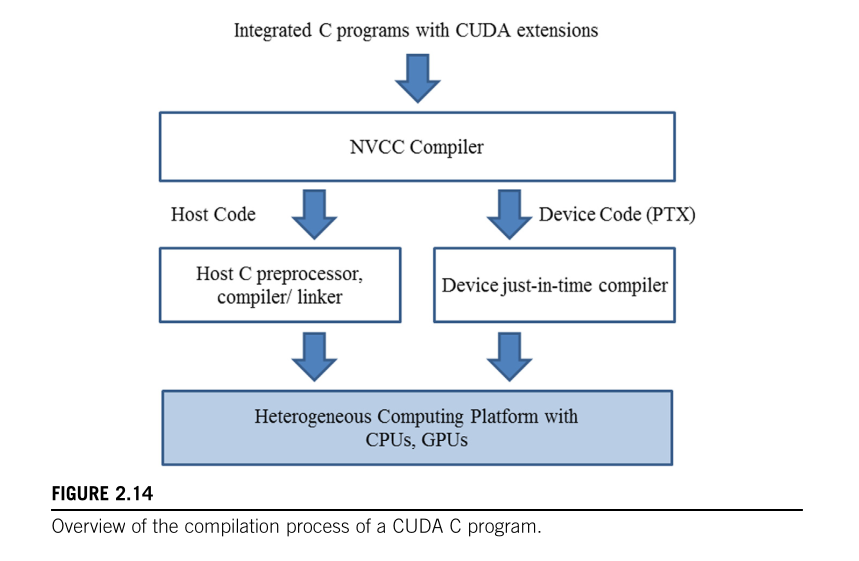

# 2.7 Compilation

> **Reference:** PMPP Chapter 2, Section 2.7  
> **Key Concepts:** NVCC (Compiler Driver), Host Code vs Device Code separation, PTX (intermediate code), SASS (machine binary), Fatbinary, Just-In-Time (JIT) Compilation, Forward Compatibility.

---

## 1. Why `gcc` or `g++` Cannot Compile CUDA Code Alone

CUDA source files incorporate domain-specific extensions absent from standard C or C++:
- `__global__` keyword
- `<<<numBlocks, threadsPerBlock>>>` kernel launch syntax
- `threadIdx.x`, `blockIdx.x` built-in variables
- CUDA API calls like `cudaMalloc`, `cudaMemcpy`, `cudaFree`

Attempting to compile a `.cu` file with a standard C compiler like `gcc` produces syntax errors: `gcc` does not recognize CUDA keywords like `__global__` or chevron syntax `<<< >>>`.

Consequently, compilation requires the specialized **`nvcc`** (NVIDIA CUDA Compiler Driver).

---

## 2. What is `nvcc`? (It's a "Compiler Driver", Not Just a Compiler)

`nvcc` is not a monolithic compiler, but a **Compiler Driver**—a coordinator that manages multiple distinct toolchains behind a unified interface.

When executing `nvcc program.cu -o program`, the driver coordinates two parallel pipelines:

Because a `.cu` file contains a **mix** of Host Code (CPU code) and Device Code (GPU code), `nvcc` **separates** them into two independent paths:

1. **Host Code Path:** `nvcc` isolates the host code (e.g., `main()`, memory setup), replaces kernel launch syntax with CUDA runtime API calls, and forwards the preprocessed source to the system's host C/C++ compiler (`gcc` on Linux, MSVC on Windows) to generate host machine binary.

2. **Device Code Path:** The GPU-specific code (kernels, device functions) is sent through NVIDIA's **own proprietary compilation pipeline**. This is where PTX and SASS come in (explained below).

Both paths produce their outputs, and `nvcc` **bundles everything together** into one single final executable.

### Figure 2.14 — Overview of the Compilation Process



**Reading the diagram:**
- Source input: The unified `.cu` source file enters `nvcc`.
- `nvcc` splits it into two streams:
  - **Left:** Host Code → goes to the normal Host C preprocessor, compiler, and linker.
  - **Right:** Device Code → gets compiled into PTX → then goes to the "Device just-in-time compiler."
- Both streams merge at the bottom into the heterogeneous computing platform (CPU + GPU).

---

## 3. PTX vs. SASS — The Two Levels of Device Code

This is the **critical** distinction that explains everything about JIT compilation and forward compatibility.

### 3.1 What is PTX? (Parallel Thread Execution)

PTX (Parallel Thread Execution) is **intermediate virtual assembly**—an instruction set architecture (ISA) independent of any specific physical GPU generation.

Think of it like this:
- *Analogy:* PTX is exactly like **Java Bytecode** (`.class` files). Java source code gets compiled into bytecode, but bytecode doesn't run directly on any CPU. It needs the JVM (Java Virtual Machine) to translate it into real machine code first.
- Same idea: CUDA source code gets compiled into PTX, but PTX doesn't run directly on any GPU. It needs one more compilation step to turn it into real machine code.

### 3.2 What is SASS? (Streaming ASSembler)

SASS is the **actual binary machine code** that the GPU hardware executes directly. SASS is the final product — the real 1s and 0s that the GPU's silicon understands.

**Critical fact:** SASS is tied to a **very specific** GPU architecture.
- SASS compiled for Ampere (`sm_86`, corresponding to the RTX 3060) contains binary opcodes specific to Ampere SM execution units.
- Different GPU generations have different physical instruction sets (ISA). The actual binary patterns for "add two numbers" or "load from memory" are literally different bit sequences on different architectures.

---

## 4. The "Fatbinary" — One Executable, Multiple Code Formats Inside

When compiling via `nvcc`, the output executable is structured as a **Fatbinary**—an ELF/PE container packaging multiple representations together:

No separate `.ptx` or `.sass` files are required on disk; all components reside packaged within the final binary.

### Proof: Inspecting a Fatbinary with `cuobjdump`

The NVIDIA `cuobjdump` utility disassembles and inspects the internal PTX and SASS sections of compiled fatbinaries.

```bash
# Compile a simple CUDA program
$ nvcc test.cu -o test

# Look inside the executable — find the PTX (intermediate code)
$ cuobjdump -ptx test

Fatbin ptx code:
================
arch = sm_86   <-- Architecture target
code version = [7,4]
...
.visible .entry _Z9my_kernelv(
)
{
        .reg .b32       %r<2>;
        mov.u32         %r1, %tid.x;  <-- PTX instruction (human-readable!)
        ret;
}
```

```bash
# Look inside the same executable — find the SASS (real machine binary)
$ cuobjdump -sass test

Fatbin elf code:
================
arch = sm_86
...
        /*0000*/                   MOV R1, c[0x0][0x28] ;    <-- SASS machine code
        /*0010*/                   S2R R0, SR_TID.X ;        <-- SASS machine code
        /*0020*/                   EXIT ;
```

**Both PTX and SASS are right there inside the same executable file!**

---

## 5. Doubt: "What Does 'Just-In-Time (JIT) Compiler' Mean?"

### 5.1 The Original Doubt

The book's Figure 2.14 shows a box labeled **"Device just-in-time compiler"** on the right side. And the book says:

> *"These PTX files are further compiled by a runtime component of NVCC into the real object files and executed on a CUDA-capable GPU device"*

Consider the technical distinction: *"What does 'Just-In-Time' (JIT) compilation signify in CUDA? Is it analogous to Python execution?"*

### 5.2 The Answer: JIT Is NOT Like Python

CUDA JIT differs fundamentally from interpreted languages like Python:

- **Ahead-Of-Time (AOT) Compilation:** `nvcc` compiles source directly into hardware SASS binary during the build phase. Startup is instantaneous, but execution is bound to target architectures specified at compile time.
- **Just-In-Time (JIT) compilation** = The CUDA **Driver** (not `nvcc`!) compiles PTX into SASS at **runtime**, right before the kernel is about to execute on the GPU.

### 5.3 Correcting the Book's Wording

The book says *"a runtime component of NVCC"* — this is slightly misleading. It is NOT `nvcc` doing the JIT compilation. `nvcc` is only involved at compile time. Once `nvcc` produces the fatbinary, its job is **done forever**. It is never called again.

Runtime JIT compilation is performed by the **CUDA Driver** (`libcuda.so` on Linux, `nvcuda.dll` on Windows)—not by `nvcc`. The driver embeds an internal PTX translation compiler.

---

## 6. Architectural Analysis: Compile-Time vs. Runtime JIT Execution

### 6.1 The Original Doubt

Consider the apparent paradox: if compilation occurs prior to execution (e.g., `nvcc test.cu -o a.out`), how does runtime JIT compilation fit into the workflow?

### 6.2 The Answer: Both Are True — Here's How

Under standard workflows, `nvcc` performs Ahead-Of-Time (AOT) compilation, generating target SASS directly. Runtime compilation serves as a **transparent fallback mechanism** when an executable encounters a newer GPU architecture than was targeted during the initial build.

**Normal case (Ahead-Of-Time):**
Consider an executable compiled with SASS targeting Ampere (`sm_86`) that is subsequently executed on a newer Blackwell GPU (`sm_100`):

**JIT case (Forward Compatibility fallback):**
Executing that identical binary on a newer GPU architecture behaves as follows:

### 6.3 The Clear Picture — Compile Time vs. Runtime

```
Compile time (Ahead-Of-Time):
   nvcc program.cu -o program
   └── nvcc generates fatbinary containing SASS + PTX
   └── nvcc's job is DONE. It is never called again.

Runtime execution:
   ./program
   └── CUDA Driver checks: "Does the SASS match this GPU?"
       ├── YES → Load SASS directly, run it. Done.
       └── NO  → Take PTX, JIT-compile to new SASS, run it.
```

**Key Takeaway:** When targeting the local hardware directly, compilation occurs Ahead-Of-Time via `nvcc`. Runtime JIT compilation triggers exclusively when an executable encounters a GPU lacking matching SASS inside the fatbinary container.

---

## 7. Doubt: "Can Old Code Run on New GPUs? Can New Code Run on Old GPUs?"

### 7.1 First, Let's Get the Terminology Right — Forward vs. Backward Compatibility

Compatibility divides into two distinct architectural perspectives: hardware and software.

**From the Hardware's perspective:**

| Term | Meaning | Example |
|------|---------|---------|
| **Hardware Backward Compatibility** | **NEW hardware** can run **OLD software** | A 2026 Intel CPU running a `.exe` compiled in 2005. The new CPU is built to still understand the old instructions. |
| **Hardware Forward Compatibility** | **OLD hardware** can run **NEW software** | Almost never works. Old hardware doesn't have the physical circuits for new instructions. |

**From the Software's perspective:**

| Term | Meaning | Example |
|------|---------|---------|
| **Software Forward Compatibility** | **OLD software** can run on **NEW hardware/environment** | A program compiled in 2020 still executes when upgrading to a newer GPU architecture. Legacy code adapts to the new hardware environment. |
| **Software Backward Compatibility** | **NEW software** can run on **OLD hardware/environment** | A program compiled with the latest toolkit still works on an older GPU. The new code is designed to work on older environments. |

**The key GPU vs CPU difference:**

CPUs (like Intel x86) have **hardware backward compatibility** — a 2026 CPU can still understand instructions from a 2005 CPU because Intel deliberately keeps the old instruction set working in every new generation.

GPUs **DO NOT** have hardware backward compatibility for SASS. NVIDIA changes the physical Instruction Set Architecture (ISA) between GPU generations. The actual binary patterns (the 1s and 0s) that represent instructions on an Ampere GPU are literally different bit sequences than on a Turing GPU or Ada Lovelace GPU. A new GPU does NOT understand old SASS, and an old GPU does NOT understand new SASS.

### 7.2 The Compatibility Rules for SASS (Machine Binary)

Since NVIDIA changes the ISA between GPU generations, SASS fails in **both** directions:

| Scenario | What Happens | Works? | Why? |
|----------|-------------|--------|------|
| Old SASS (RTX 3060, Ampere) on New GPU (RTX 5090, Blackwell) | New GPU doesn't understand old SASS instructions | ❌ **Fails** | No hardware backward compatibility — new GPU has a different ISA |
| New SASS (RTX 5090, Blackwell) on Old GPU (RTX 3060, Ampere) | Old GPU doesn't understand new SASS instructions | ❌ **Fails** | No hardware forward compatibility — old GPU lacks the new physical circuits |

**SASS fails in BOTH directions.** This is completely unlike CPUs where old binaries run on new hardware.

### 7.3 The Compatibility Rules for PTX (Intermediate Code)

PTX is where the magic of **software forward compatibility** happens:

| Scenario | What Happens | Works? | Type of Compatibility |
|----------|-------------|--------|-----------------------|
| Old PTX on New GPU | CUDA Driver JIT-compiles old PTX into new SASS for the new GPU | ✅ **Works!** | **Software Forward Compatibility** — old code runs on new hardware |
| New PTX on Old GPU | PTX references hardware features that don't physically exist on the old GPU | ❌ **Fails** | No software backward compatibility — new code needs features the old GPU doesn't have |

**This is the entire reason PTX exists!** Since SASS breaks across generations, NVIDIA needed a "universal bridge" format. Old PTX can always be JIT-compiled into whatever the new GPU needs. But new PTX cannot run on old GPUs because the new PTX might reference hardware features (like newer Tensor Core instructions) that simply do not physically exist on the older GPU.

### 7.4 The Complete Compatibility Picture

Here is every combination in one table:

| Code Type | Direction | Works? | Mechanism |
|-----------|-----------|--------|-----------|
| Old SASS → New GPU | Forward | ❌ | Different ISA, new GPU can't read old binary |
| New SASS → Old GPU | Backward | ❌ | Different ISA, old GPU can't read new binary |
| Old PTX → New GPU | Forward | ✅ | CUDA Driver JIT-compiles PTX into new SASS |
| New PTX → Old GPU | Backward | ❌ | Old GPU lacks physical hardware features the new PTX expects |

**Bottom line:** The ONLY working combination is **old PTX on a new GPU**, and that only works because the CUDA Driver acts as a JIT compiler bridge between the old intermediate code and the new hardware.

### 7.5 Why the Fatbinary Contains Both

Now it makes perfect sense why `nvcc` bundles both SASS **and** PTX into the fatbinary:

- **SASS** = Maximal performance on target architectures without runtime JIT latency.
- **PTX** = Virtual intermediate representation ensuring software forward compatibility. If executed on a newer GPU lacking native SASS, the CUDA Driver JIT-compiles the PTX into native machine opcodes.

### 7.6 So Who Provides Forward Compatibility — `nvcc` or the CUDA Driver?

The **CUDA Driver** (installed on the host execution system) translates PTX to SASS at runtime, not `nvcc`.

At runtime, it's the CUDA Driver that:
1. Opens the fatbinary
2. Checks if the bundled SASS matches the current GPU
3. If not, takes the PTX and JIT-compiles it into new SASS
4. Caches the result (at `~/.nv/ComputeCache`) so it doesn't have to JIT again next time
5. Runs the new SASS on the GPU

Provided the host system contains an updated **CUDA Driver**, the driver JIT-compiles embedded PTX into native machine instructions for the newly detected GPU.

---

## 8. Quick Reference Summary

| Concept | Key Point |
|---------|-----------|
| Why `nvcc`? | Normal C compilers (`gcc`) can't understand CUDA extensions (`__global__`, `<<<...>>>`) |
| `nvcc` role | Compiler Driver — splits code into Host path (→ `gcc`) and Device path (→ NVIDIA pipeline) |
| PTX | Intermediate code (like Java Bytecode). GPU cannot execute it directly |
| SASS | Real machine binary. GPU executes this directly. Architecture-specific |
| Fatbinary | The final executable contains BOTH SASS and PTX bundled together |
| JIT compiler | The **CUDA Driver** (not `nvcc`!) that compiles PTX → SASS at runtime if needed |
| JIT vs Python | JIT is NOT interpretation. It is a full compilation step that produces real binary |
| When JIT happens | Only when the pre-compiled SASS doesn't match the current GPU (fallback!) |
| Hardware Backward Compat | NEW hardware runs OLD software. CPUs have it. GPUs do NOT (for SASS) |
| Hardware Forward Compat | OLD hardware runs NEW software. Almost never works (missing physical circuits) |
| Software Forward Compat | OLD software runs on NEW hardware. ✅ PTX enables this via JIT! |
| Software Backward Compat | NEW software runs on OLD hardware. ❌ Fails (old GPU lacks new features) |
| Old SASS on New GPU | ❌ Fails (different ISA) |
| New SASS on Old GPU | ❌ Fails (different ISA) |
| Old PTX on New GPU | ✅ Works (CUDA Driver JIT-compiles it) |
| New PTX on Old GPU | ❌ Fails (missing hardware features) |
| Forward Compatibility | Provided by CUDA Driver + PTX, not by `nvcc` |
