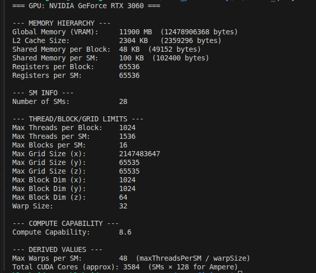

# GPU Hardware Clarity — Common Doubts Answered

> **Target GPU: NVIDIA GeForce RTX 3060**
>
> - Architecture: Ampere (Compute Capability 8.6)
> - VRAM: 12 GiB GDDR6 (12,288 MiB = 12,884,901,888 bytes physical; CUDA reports ~11,900 MiB available)
> - SMs: 28
> - CUDA Cores per SM: 128 (Total: 3584)
> - Tensor Cores per SM: 4
> - L2 Cache: 2.25 MB (2,304 KB = 2,359,296 bytes)
> - SRAM per SM: 128 KB (split between L1 cache and shared memory)
> - Max Threads per Block: 1024
> - Max Threads per SM: 1536
> - Max Blocks per SM: 16
> - Max Warps per SM: 48
> - Warp Schedulers per SM: 4
> - Registers per SM: 65,536 (256 KB register file)
> - Registers per Block: 65,536
> - Max Grid Size: (x) 2^31 - 1, (y) 65,535, (z) 65,535
> - Max Block Dim: (x) 1024, (y) 1024, (z) 64
> - Warp Size: 32

These specifications were obtained by running [`device_query.cu`](device_query/device_query.cu) which uses `cudaGetDeviceProperties()`. See the [actual output screenshot](#device_querycu--actual-output-proof) at the bottom of this document.

---

## What Is Global Memory / VRAM / DRAM?

These are all the SAME thing — the big main memory on the GPU card.

```
Global Memory (VRAM):  12 GiB on the RTX 3060
                       = 12,288 MiB = 12,884,901,888 bytes (physical)
```

This is the GDDR6 memory chips physically soldered onto the GPU card. NVIDIA calls it "global memory" in CUDA. Hardware people call it VRAM or DRAM. Accessible by ALL threads in ALL blocks across ALL SMs. Large but slow.

### Why does CUDA report ~11,900 MiB instead of 12,288 MiB?

The GPU physically has **12 GiB** (12,288 MiB) of GDDR6 VRAM — confirmed by `nvidia-smi` which reports exactly `12288 MiB`. But `cudaGetDeviceProperties().totalGlobalMem` reports what is **available to CUDA programs**, not the raw physical total:

```
nvidia-smi reports:        12,288 MiB  = 12,884,901,888 bytes  (physical total)
CUDA totalGlobalMem:       11,900 MiB  = 12,478,906,368 bytes  (available to CUDA)
Difference:                  ~387 MiB  = 405,995,520 bytes     (reserved by system)
```

The missing ~387 MiB is reserved by:

- **Display/framebuffer** — the GPU is driving the monitor (Xorg, GNOME Shell compositor)
- **Driver internal allocations** — NVIDIA driver reserves memory for page tables, context management
- **Other GPU processes** — any application using the GPU (browsers, compositors, etc.)

This number will change depending on what else is running on the GPU. The physical VRAM is exactly **12 GiB = 12,288 MiB**. The number "12,288" is MiB (12 × 1024 = 12,288) because memory uses binary units (powers of 1024, not 1000).

---

## What Is L2 Cache? Why Does It Exist?

```
L2 Cache: 2.25 MB on the RTX 3060
```

L2 cache sits BETWEEN the SMs and VRAM. It's shared by ALL 28 SMs.

### Why not just go directly from VRAM to L1?

Because L1 is PER SM. If SM #0 and SM #15 both need the same data, without L2 they'd BOTH have to go all the way to VRAM (slow). With L2, the data gets cached in one central place. SM #0 reads it from VRAM → gets cached in L2. SM #15 then finds it in L2 (fast) instead of going to VRAM again.

L2 is the "shared middle layer" that prevents every SM from independently hammering the slow VRAM.

### What if data exceeds 2.25 MB?

It does NOT fail. L2 is a CACHE, not storage. It only holds the most recently accessed data. When full, it evicts the oldest/least-used data to make room for new data.

```
Thread reads address A → not in L2 → fetched from VRAM → cached in L2
Thread reads address B → not in L2 → fetched from VRAM → cached in L2
...L2 fills up...
Thread reads address X → not in L2 → fetched from VRAM →
    L2 EVICTS oldest entry → caches X
Thread reads address A again →
    Maybe still in L2 (cache hit = fast!)
    Maybe evicted (cache miss = go to VRAM again, slow)
```

If the working set fits in 2.25 MB → lots of cache hits (fast). If huge → lots of cache misses (slow, goes to VRAM).

### Why only 2.25 MB? Why not more?

Fast memory (SRAM) is expensive to build — takes more silicon area, more power, more money. NVIDIA chose 2.25 MB as a tradeoff for this GPU tier. Other GPUs have different amounts:

```
RTX 3060 (Ampere):   2.25 MB L2
RTX 3090 (Ampere):   6 MB L2
RTX 4090 (Ada):      72 MB L2     ← massive jump!
A100 (datacenter):   40 MB L2
H100 (datacenter):   50 MB L2
```

---

## The 128 KB SRAM Per SM — L1 Cache and Shared Memory

Each of the 28 SMs has its own separate 128 KB SRAM. SM #0's SRAM is completely independent from SM #15's SRAM.

```
GPU Die:
┌─────────┬─────────┬─────────┬─────────┐
│  SM #0  │  SM #1  │  SM #2  │  SM #3  │
│ 128KB   │ 128KB   │ 128KB   │ 128KB   │
│ SRAM    │ SRAM    │ SRAM    │ SRAM    │
├─────────┴─────────┴─────────┴─────────┤
│          L2 Cache (2.25 MB)            │  ← shared by ALL SMs
├────────────────────────────────────────┤
│          VRAM (12 GB GDDR6)            │  ← shared by ALL SMs
└────────────────────────────────────────┘
```

### This SRAM is NOT just "L1 cache." It is SPLIT into two parts

```
128 KB SRAM on each SM
┌──────────────────────────────────────────┐
│   Part 1: SHARED MEMORY                  │
│   - Programmer-controlled (explicit code)│
│   - Visible to threads in SAME BLOCK only │
│   - Max configurable: 100 KB per SM       │
│   - Default max per block: 48 KB          │
│──────────────────────────────────────────│
│   Part 2: L1 CACHE                        │
│   - Hardware-controlled (automatic)       │
│   - No code needed (automatic)              │
│   - Hardware decides what to cache         │
│   - Gets whatever KB is left after shared │
└──────────────────────────────────────────┘
```

### Shared memory — who sees it?

Shared memory is PER BLOCK, not per SM. Each block gets its own private chunk. Block 0 cannot see Block 2's shared memory, even if both are on the same SM.

```
SM #0:
  Block 0:  shared_mem_0[...]  ← ONLY Block 0's threads can access this
  Block 2:  shared_mem_2[...]  ← ONLY Block 2's threads can access this

  Block 0's Thread 5 tries to read shared_mem_2? IMPOSSIBLE.
```

### L1 cache — who sees it?

L1 cache is transparent. No thread writes code saying "read from L1 cache." Instead:

```
// Code just reads global memory normally:
float x = global_array[i];

// Behind the scenes, hardware does:
// 1. Check L1 cache → found? Return it (fast)
// 2. Not in L1? Check L2 → found? Return it, also cache in L1
// 3. Not in L2? Go to VRAM → return it, cache in L2 AND L1
```

L1 automatically caches global memory reads for ALL threads on that SM regardless of which block they're in.

### Shared memory vs L1 cache — key differences

| | Shared Memory | L1 Cache |
|---|---|---|
| **Who controls it?** | Programmer (explicit code) | Hardware (automatic, behind the scenes) |
| **Who sees it?** | Threads in the SAME BLOCK only | All threads on that SM (transparent) |
| **Requires explicit code?** | Yes, declare `__shared__` arrays | No, happens automatically |
| **When data lands here** | Only when explicitly copied by code | Automatically when reading global memory (hardware manages it) |

### What does "100 KB shared memory per SM" vs "48 KB per block" mean?

- **48 KB** = default maximum that ONE block can request
- **100 KB** = total shared memory budget for the ENTIRE SM (split among all blocks on that SM)

### If each block uses 48 KB, how many blocks fit?

```
Total shared memory on SM:  100 KB
Each block requests:         48 KB
100 / 48 = 2.08 → only 2 blocks fit (2 × 48 = 96 KB used)
```

So yes, if every block uses 48 KB shared memory, only 2 blocks can run per SM.

### What about the remaining 28 KB (128 - 100)?

That 28 KB is used as **L1 cache**. It is NOT idle. It is NOT L2 cache. The hardware automatically uses it to cache global memory reads. The split is flexible:

```
Config 1: 100 KB shared memory + 28 KB L1 cache  = 128 KB
Config 2: 64 KB shared memory  + 64 KB L1 cache  = 128 KB
Config 3: 48 KB shared memory  + 80 KB L1 cache  = 128 KB
Config 4: 0 KB shared memory   + 128 KB L1 cache = 128 KB
```

If a kernel uses lots of shared memory, L1 gets smaller. If a kernel uses none, L1 gets the full space. In CUDA, `cudaFuncSetAttribute()` can adjust this split.

### Why Use Shared Memory if L1 is Automatic? ("Conscious Temporary Storage")

Since L1 is automatic and fast, why bother writing code for shared memory?
Because L1 cache is controlled by the hardware — data can be evicted at any moment if the GPU needs that space. With Shared Memory, memory allocation is completely deterministic. Data stays resident until the block completes.

**Example of why this matters:**
Consider multiplying two massive matrices (e.g., 10,000 × 10,000). To calculate just one cell of the output, an entire row of Matrix A and an entire column of Matrix B must be read.
If 1024 threads in a block all read from VRAM simultaneously, VRAM chokes.
Instead, using shared memory:

1. Thread 0 reads ONE value into shared memory. Thread 1 reads ONE value. etc.
2. `__syncthreads()` (Wait for all to finish loading a small "tile" of data)
3. Now all 1024 threads compute using the data in shared memory (0 cycle delay, no eviction risk).
4. Move to the next tile.

Shared memory allows threads to **cooperate** on data loads. L1 cache cannot guarantee cooperation because it evicts data randomly.

---

## Threads, Blocks, Grids, and SMs

### Definitions

- **Thread** = smallest unit. One thread executes one instance of the kernel function.
- **Block** = group of threads (up to 1024). All threads in a block run on the SAME SM and can cooperate via shared memory and `__syncthreads()`.
- **Grid** = ALL blocks launched for one kernel. 1 kernel = 1 grid. Can have up to 2^31-1 blocks.
- **SM** = Streaming Multiprocessor. Hardware processing unit. The RTX 3060 GPU has 28 SMs.

### Can an SM run more than one block?

Yes! An SM can run MULTIPLE blocks at the same time. Not just one. The limit is on total threads per SM, not on blocks per SM.

- Max threads **per block** = 1024 (hard limit — a single block cannot exceed this)
- Max threads **per SM** = 1536 (total across ALL blocks on that SM)

So if each block has 256 threads, one SM can run 1536/256 = 6 blocks simultaneously. If each block has 1024 threads, the SM can only run 1 block (since 2 × 1024 = 2048 exceeds 1536).

### Threads per SM: 1536 vs 1024 — both are correct but mean different things

- **1024** = maximum threads in ONE block. A single block cannot have more than 1024 threads.
- **1536** = maximum threads an SM can manage at the same time. This can come from MULTIPLE blocks.

```
Valid configurations on one SM:
  1 block × 1024 threads = 1024 total   (OK, under 1536)
  3 blocks × 512 threads = 1536 total   (OK, exactly at limit)
  6 blocks × 256 threads = 1536 total   (OK)

  NOT possible:
  2 blocks × 1024 threads = 2048        (exceeds 1536 per SM!)
  1 block × 1536 threads                (exceeds 1024 per block!)
```

### What About 1 Thread per Block — Can 1024 Blocks Launch in an SM?

No. Even with 1-thread blocks, the **max blocks per SM limit of 16** is reached. So with 1-thread blocks, only 16 blocks fit on one SM, utilizing only 16 of the 1,536 thread slots. That results in extreme underutilization — 1,520 thread slots sitting empty.

### Where do blocks live?

A block is always assigned to exactly ONE SM. It runs entirely there and never moves. When it finishes, the SM is free to take the next waiting block.

A block CANNOT be bigger than what an SM can handle (max 1024 threads per block).

```
SM #0                    SM #1                    SM #2
┌──────────────┐        ┌──────────────┐        ┌──────────────┐
│  Block 0     │        │  Block 3     │        │  Block 1     │
│  Block 2     │        │  Block 7     │        │  Block 5     │
│  Block 6     │        │              │        │  Block 9     │
└──────────────┘        └──────────────┘        └──────────────┘
```

The GPU's hardware scheduler decides which SM gets which block. The programmer does not control this.

### How many blocks per SM?

Multiple limits compete — the TIGHTEST one wins:

1. Max blocks per SM:        16
2. Max threads per SM:       1536
3. Shared memory per SM:     100 KB
4. Registers per SM:         65,536

*(See the "Occupancy and The Tightest Limit: 10 Comprehensive Examples" section at the end of this document for detailed calculations).*

### Grid size (2^31-1) vs SM occupancy (16) — NOT contradictory

It is often noted that 2^31-1 blocks can be initialized in software, yet max blocks per SM is only 16. Both are correct but mean different things:

- **2^31-1** = the total number of blocks launchable in ONE kernel (the API's **software grid limit**).
- **16** = the hardware limit for how many blocks ONE SM can physically execute at any given moment (the **hardware occupancy limit**).

The GPU acts as a queuing system. For an RTX 3060 with 28 SMs, the **absolute maximum hardware concurrency** is 28 SMs × 16 blocks per SM = **448 blocks** executing simultaneously across the entire GPU (assuming the blocks are small enough to hit this limit).

However, the API can be instructed to launch up to **2,147,483,647 blocks**. The hardware scheduler manages the massive queue automatically.

**Let's trace an exact example:**
Consider a kernel launch: `my_kernel<<<2,000,000, 256>>>()`.

1. This initializes a software grid of 2,000,000 blocks.
2. Because the configuration specifies **256 threads per block**, the "Tightest Limit" rule kicks in. The SM can only handle 1536 threads total.
3. 1536 / 256 = **6 blocks per SM**.
4. Across the whole GPU (28 SMs), the hardware can physically hold **168 blocks resident simultaneously** (28 SMs × 6 blocks).

**The Dynamic Dispatch (The Conveyor Belt):**
The GPU hardware scheduler (the Gigathread Engine) loads the first 168 blocks onto the SMs for execution. The remaining 1,999,832 blocks wait in the hardware queue.
Here is the critical detail: **The SM does NOT wait for all 6 blocks to finish before loading more.**
As soon as *one single block* completes its instructions and frees its threads/registers, the scheduler grabs the very next block from the queue and shoves it onto the SM instantly. It is a continuous, dynamic conveyor belt replacing blocks one-by-one to maintain 100% occupancy.

*(Note on execution time: A single clock cycle only processes ONE instruction for a warp. Because a kernel has hundreds of instructions and memory fetches, it takes thousands or tens of thousands of clock cycles to complete a single block, not just 2 clock cycles).*

### Why do grids and blocks have X, Y, Z dimensions?

A grid doesn't have to just be a flat line of blocks. It can be a 2D or 3D grid. Same for threads inside a block.

**Why? For logical mapping to real-world problems.**

- **1D (X only):** Processing an array of numbers `[1, 2, 3, 4, 5]`
- **2D (X, Y):** Processing an Image (pixels have x, y coordinates) or a Matrix.
- **3D (X, Y, Z):** Processing a 3D medical MRI scan, or fluid dynamics in a 3D box.

If dimensions are omitted, Y and Z default to `1`. For non-3D computations, Y and Z remain `1`.

### What are the Dimension Limits and Why?

**Block Dimensions:**

- X Max: 1024
- Y Max: 1024
- Z Max: **64**
- *Total threads (X × Y × Z) cannot exceed 1024.*

Why is Z limited to 64 while X and Y get 1024? This is a **hardware addressing limitation**. Inside the silicon, the GPU uses a 10-bit register to store the X and Y indices ($2^{10} = 1024$), but to save silicon area, it only allocates 6 bits for the Z index ($2^6 = 64$).

**Grid Dimensions:**

- X Max: $2^{31}-1$ (over 2 billion)
- Y Max: 65,535
- Z Max: 65,535

Why are Y and Z grids limited to 65,535 ($2^{16}-1$)? **Legacy architecture.** In very old CUDA architectures (pre-2012), the limit for ALL dimensions was 65,535 because they used 16-bit integers to store grid coordinates. In Compute Capability 3.0, NVIDIA upgraded the X-dimension to a 32-bit integer (allowing 2 billion blocks), but left Y and Z at 16-bit to save space because $65535 \times 65535$ blocks is already massive for 2D/3D grids.

---

## What Does `__syncthreads()` Do?

It's a barrier that works ONLY within one block. When a thread hits `__syncthreads()`, it stops and waits until EVERY thread in the same block has also reached that line. Then they all continue together.

```
Block 0 (4 threads):
  Thread 0:  step_A()  →  __syncthreads()  →  step_B()
  Thread 1:  step_A()  →  __syncthreads()  →  step_B()
  Thread 2:  step_A()  →  __syncthreads()  →  step_B()
  Thread 3:  step_A()  →  __syncthreads()  →  step_B()

  Thread 2 finishes step_A first. WAITS at barrier.
  Thread 0 finishes. WAITS.
  Thread 3 finishes. WAITS.
  Thread 1 finishes last. NOW all 4 are at barrier.
  → All 4 proceed to step_B together.
```

**Why is this useful?** If thread 0 writes a result to shared memory in step_A, and thread 3 needs to read that result in step_B, the barrier guarantees thread 0 has finished writing before thread 3 tries to read it.

**Critical rule:** `__syncthreads()` ONLY synchronizes threads WITHIN the same block. It does NOT work across different blocks. Block 0 and Block 1 cannot use `__syncthreads()` to coordinate.

### How Does Synchronization Occur ACROSS Blocks?

Two options:

**Option A: Launch a second kernel.** When a kernel finishes, ALL blocks are guaranteed complete. So launch kernel 1, let it finish, then launch kernel 2 that reads kernel 1's results. The kernel boundary is the synchronization point.

**Option B: Use atomic operations.** An atomic operation is a special hardware instruction that lets multiple threads safely write to the SAME global memory location without corrupting the data. For example, `atomicAdd(&total, value)` means "add a value to the total, and the hardware guarantees that no two threads corrupt each other even if they do it at the same time."

```
Example — each block adds its partial sum to a global total:
  Thread 0 of Block 0:  atomicAdd(&global_total, block_0_sum)
  Thread 0 of Block 1:  atomicAdd(&global_total, block_1_sum)
  Thread 0 of Block 2:  atomicAdd(&global_total, block_2_sum)
  ...
  Hardware ensures no corruption, even though all write to &global_total
```

Atomic operations are simpler (one kernel instead of two), but can be slow if thousands of threads hit the same address.

---

## 48 Warps But Only 4 Warp Schedulers — What Does "Concurrent" Mean?

The RTX 3060 has 48 max warps per SM and 4 warp schedulers per SM. This means 48 × 32 = 1536 threads concurrently per SM. But if only 4 warps execute per cycle, what does "concurrently" actually mean?

**4 warp schedulers = at any SINGLE clock cycle, only 4 warps execute instructions.** One warp per scheduler.

**The other 44 warps are WAITING:**

- Waiting for data from global memory (takes 200-400 clock cycles!)
- Waiting at a `__syncthreads()` barrier
- Waiting for a computation result
- Waiting for their turn

### This is called LATENCY HIDING

```
Clock cycle 1:
  Scheduler 0 → Warp 0: ADD instruction
  Scheduler 1 → Warp 1: ADD instruction
  Scheduler 2 → Warp 2: LOAD from global memory (will take 300 cycles!)
  Scheduler 3 → Warp 3: MUL instruction

Clock cycle 2:
  Warp 2 is STALLED (waiting for memory)
  → Scheduler instantly switches to Warp 4 (ready!)
  The switch costs ZERO cycles. No penalty.

...300 cycles later...
  Warp 2's data arrives → Warp 2 is "ready" again
  Next free scheduler picks it up and continues
```

**"Concurrent" means:** all 48 warps are loaded and managed by the SM. At any instant, 4 execute and 44 wait. But the scheduler switches SO FAST (every clock cycle) that all 48 make progress over time. It does NOT mean all 48 execute at the same clock cycle.

### 28 SMs × 1536 threads = 43,008 "concurrent" threads

```
Resident (concurrent):    28 × 1536 = 43,008 threads  (loaded, managed, ready)
Actually executing:       28 × 4 × 32 = 3,584 threads (at any one clock cycle)
```

If a launch exceeds 43,008 threads worth of blocks, the extra blocks wait in a hardware queue until running blocks finish.

---

## Warp Execution: Loop Unrolling and Warp Divergence

To truly understand how GPU hardware optimizes code, examining how the compiler and the SM execute instructions is essential.

### What is Loop Unrolling?

**Loop Unrolling** is an extremely powerful optimization technique performed entirely by the **compiler at compile-time** (long before the code ever reaches the GPU hardware).

A normal loop is computationally expensive because of hidden "bookkeeping" overhead. Let's look at a simple, 4-iteration addition loop:

```cpp
// A simple loop adding 4 numbers
float sum = 0.0f;
for (int i = 0; i < 4; i++) {
    sum += array[i];
}
```

Writing this loop might suggest the hardware executes only 4 addition instructions. In reality, a traditional loop incurs substantial overhead:

1. **The Math:** `sum += array[i]` (The actual useful work)
2. **The Counter Update:** `i++` (Add 1 to `i`)
3. **The Condition Check:** `i < 4` (Is `i` still less than 4?)
4. **The Branch Jump:** `JMP` (Jump the program counter back to the top of the loop)

For a 4-iteration loop, the hardware actually executes **16 instructions** (4 useful additions + 12 bookkeeping instructions). Those bookkeeping instructions do absolutely zero useful math—they just keep the loop machinery turning, wasting precious clock cycles and potentially stalling the execution pipeline.

**How the Compiler Fixes This (Unrolling):**
Because the loop bounds (`i = 0` to `i < 4`) are **constant and explicitly known**, the compiler recognizes this at compile-time. It thinks: *"I know exactly how many times this will run. Why make the hardware jump in circles at runtime?"*

The compiler deletes the loop machinery entirely and "unrolls" the code into a straight line of instructions:

```cpp
// How the compiler rewrites the code behind the scenes:
float sum = 0.0f;
sum += array[0]; // Iteration 0
sum += array[1]; // Iteration 1
sum += array[2]; // Iteration 2
sum += array[3]; // Iteration 3
```

**Why is it such a massive optimization?**
By removing the `i++` updates, the `< 4` checks, and the `JMP` branches, the execution drops from 16 instructions down to just **4 instructions**.

1. **Zero Overhead:** 100% of the clock cycles are now spent doing actual mathematical work.
2. **No Branching Stalls:** Jump/branch instructions can cause the GPU's instruction pipeline to pause (stall). Straight-line code flows perfectly through the hardware.
3. **Instruction-Level Parallelism:** Because the instructions are laid out flat, the compiler can look ahead and schedule independent memory loads (like grabbing `array[0]` and `array[1]`) to happen simultaneously.

### What is Warp Divergence?

To understand divergence, understanding the concept of a **Warp** is essential. On the GPU, threads do not execute independently. The hardware physically groups threads into bundles of 32 called **warps**. All 32 threads in a warp run in **lockstep** — they share a single Program Counter and are forced to execute the *exact same instruction at the exact same time*.

**Warp divergence** occurs when the 32 threads in a warp are forced onto different execution paths.

Consider a `while` loop that stops processing when a specific condition is met, where that condition occurs at different times for different data items:

```cpp
// A data-dependent loop
while (data_value != 0) {
    // do work
    data_value = data_value / 2;
}
```

If Thread 0 needs 5 passes through the loop, but Thread 1 only needs 1 pass, what does the hardware do?
Since they are bound together in the same warp, they *cannot* separate. The hardware **serializes** the execution. It forces the warp to keep looping until the *slowest* thread (Thread 0) is completely finished. During passes 2, 3, 4, and 5, Thread 1 is "masked off" — it just sits idle, wasting clock cycles.

This is warp divergence: 32 threads that should have worked in parallel end up taking turns or waiting on each other, drastically reducing hardware efficiency.

### The Connection (The Link)

The relationship between these two concepts is fundamental: **One directly influences the other.**

1. **If Warp Divergence Occurs, Loop Unrolling is Impossible:**
If a loop has a pass count that depends on thread-specific data, the compiler *cannot* unroll it.

2. **Fixing the bounds eliminates Divergence and unlocks Unrolling:**
Designing algorithms with fixed, constant loop bounds guarantees that every single thread in a warp takes the exact same execution path. This eliminates warp divergence completely and allows the compiler to unroll loops.

In short: **Constant loop bounds are the key.** Constant bounds keep warps synchronized (eliminating divergence) while simultaneously allowing the compiler to remove overhead (enabling loop unrolling).

**Let's Look at a Direct Example Connecting Both:**

*(For a deeper mathematical dive into this specific problem, see Section **"4. Mathematical Proofs & Loop Edge-Cases"** in `data_accessing_techniques.md`).*

**The Context (The Problem):**
Consider a 3D tensor of shape `[2, 3, 4]`. The objective is to convert a flat 1D `linear_idx` (like 14) back into 3D coordinates `(z, y, x)`.

There are two ways to write the loop that does this:

**1. The "Bad" Way (Stopping when `linear_idx` becomes 0):**

```cpp
while (linear_idx != 0) {
    // Process one dimension
    coord = linear_idx % size;
    linear_idx = linear_idx / size;
}
```

- **Why it seems logical at first:** If `linear_idx` becomes 0 after peeling off the innermost dimensions, why keep doing math? It seems faster to just stop early.

- **The Reality:**
  - **Thread A** is given `linear_idx = 14`. It takes **3 passes** for the number to reach 0.
  - **Thread B** is given `linear_idx = 2`. It takes **1 pass** for the number to reach 0.
- **The Result on Divergence:** Because Thread B finishes in 1 pass while Thread A takes 3, Thread B is forced to sit completely idle (wasting cycles) while Thread A finishes passes 2 and 3. The warp has **diverged**.
- **The Result on Unrolling:** The compiler cannot determine how many times this loop will run for any given thread — Thread A might run 3 times, Thread B might run 1 time. Because the termination condition is dynamic, **the compiler cannot unroll this loop.**

**2. The "Good" Way (Stopping when all dimensions are completed):**

```cpp
// For a 3D tensor, dims = 3.
for (int d = dims - 1; d >= 0; d--) {
    // Process one dimension
    coord[d] = linear_idx % sizes[d];
    linear_idx = linear_idx / sizes[d];
}
```

- **Why it is mathematically correct:** Even if `linear_idx` reaches 0 early (like for Thread B), the loop must continue to ensure outermost dimensions explicitly evaluate to `0` (e.g., coordinate `[0, 0, 2]`). Terminating early leaves those outer coordinates uninitialized (garbage memory).

- **The Result on Divergence:** Because `dims` is always 3 for a 3D tensor, **Thread A** and **Thread B** both run the loop exactly **3 times**, regardless of what their `linear_idx` is. Both threads execute in perfect lockstep. No one finishes early, no one waits. Warp divergence is **completely killed**.
- **The Result on Unrolling:** The compiler looks at this code and says, "Ah, this loop always runs exactly 3 times for every single thread, guaranteed." It safely deletes the `for` loop machinery and writes the math instructions out 3 times in a straight line (unrolling it).

This is the link: **forcing the loop to run for all dimensions instead of stopping at 0 ensures mathematical correctness, eliminates warp divergence, and unlocks loop unrolling simultaneously.**

---

## Tensor Cores vs CUDA Cores for Matmul

A common question arises: with 128 CUDA cores but only 4 tensor cores per SM, are 4 tensor cores a downgrade? No — tensor cores are massive matrix engines.

**A tensor core is NOT like a CUDA core.** Don't think of "4 tensor cores" as "4 tiny things."

**One CUDA core:** does 1 multiply-add per clock cycle. `a*b + c` = 1 operation.

**One tensor core:** does a 4×4 matrix multiply-accumulate in ONE clock cycle. That's 64 multiply-add operations in a single cycle.

```
Per clock cycle:
  128 CUDA cores:   128 × 1 = 128 FMA operations
  4 Tensor cores:   4 × 64  = 256 FMA operations  (at FP16)

  Tensor cores are 2× faster minimum for matrix ops.
```

Tensor cores also work on lower precision (FP16, BF16, INT8, TF32) which further multiplies throughput. So 4 tensor cores is NOT a bottleneck — each one is a dense matrix engine. That's why deep learning frameworks route all matmul through tensor cores automatically.

---

## Complete Memory Hierarchy — Data Flow

```
                    SIZE            SPEED          WHO ACCESSES IT
                    ────            ─────          ────────────────
  Registers         256 KB total    Fastest        One thread only
       ↑
  L1 / Shared Mem   128 KB per SM   Very fast      Same SM (L1=auto, shared=same block)
       ↑
  L2 Cache          2.25 MB total   Fast           ALL SMs
       ↑
  VRAM (Global)     12 GB           Slow           ALL SMs
```

**Path A — Normal global memory read (automatic):**

```
Thread does: float x = array[i];
Hardware does: Register ← L1 ← L2 ← VRAM (caches along the way)
```

**Path B — Explicit shared memory (programmer-controlled):**

```
1. shared_mem[tid] = array[i]     // load from global → shared memory
2. __syncthreads()                 // wait for all threads to load
3. float y = shared_mem[other_tid] // read from shared memory (super fast)
```

---

## Registers — The Fastest Memory on the GPU

Registers are tiny pieces of ultra-fast storage built directly **inside** the SM's processing circuitry — not in VRAM, not in L2, not in L1/shared memory. They are where threads hold their **working variables** while executing instructions.

Every variable declared in a kernel lives in a register:

```cuda
__global__ void my_kernel(float* data) {
    int idx = threadIdx.x;        // ← 'idx' lives in a register
    float val = data[idx];        // ← 'val' lives in a register (loaded from VRAM)
    float result = val * 2.0f;    // ← 'result' lives in a register
    data[idx] = result;           // ← written back from register to VRAM
}
```

### How big is each register?

Each register is exactly **32 bits = 4 bytes**. One register holds one `int` or one `float`. A `double` (64-bit) needs **2 registers**.

Total register file per SM:

```
65,536 registers × 4 bytes each = 262,144 bytes = 256 KB per SM
```

That 256 KB is the fastest memory on the entire GPU — even faster than shared memory or L1 cache. Access time is **0 cycles** (registers are directly wired to the ALU).

### Where are registers in the hierarchy?

```
                    SIZE            SPEED              WHO SEES IT
                    ────            ─────              ───────────
  Registers         256 KB/SM       FASTEST (0 cycles) One thread ONLY (private)
       ↑
  L1 / Shared Mem   128 KB/SM       Very fast (~30 cy) Same SM (shared=same block)
       ↑
  L2 Cache          2.25 MB total   Fast (~100 cycles)  ALL SMs
       ↑
  VRAM (Global)     12 GiB          Slow (200-400 cy)  ALL SMs
```

Registers are **private to each thread**. Thread 0 cannot see Thread 1's registers. Ever. No sharing, no synchronization — each thread has its own private set of registers allocated when its block starts.

### Why Registers per Block = Registers per SM = 65,536?

**The byte-level math:**
Each register is **32 bits = 4 bytes**. The SM has a **256 KB register file** (physical SRAM on the chip).
256 KB = 256 × 1024 = 262,144 bytes.
262,144 bytes ÷ 4 bytes per register = **65,536 registers**. That is the physical pool.

**Why are "per Block" and "per SM" the same number?**

- **Registers per SM = 65,536** → The SM has a physical pool of 65,536 registers. This is the hardware total.
- **Registers per Block = 65,536** → A single block is ALLOWED to consume up to ALL 65,536 registers on the SM.

These being equal means NVIDIA placed **no artificial per-block cap** on this GPU. A single block is allowed to consume the entire register file if needed. But if it does, NO other block can run on that SM at the same time (zero registers left for a second block).

Not all GPUs have this property. On some older architectures, the per-block cap was lower than the per-SM total (e.g., a block could only use 32,768 registers even though the SM had 65,536). On the RTX 3060 (CC 8.6), they happen to be equal.

**Worked example: Can a single block really consume all 65,536 registers?**

Yes. Let's prove it:

```
65536/255 = 257.003.. = ~257
Kernel config: 257 threads per block, 255 registers per thread, 0 KB shared memory.

Step 1 — Register demand:
  257 threads × 255 registers/thread = 65,535 registers needed.
  The SM has 65,536 registers. This fits (barely — only 1 register left over).

Step 2 — Apply all 4 limits:
  Block Limit:    16 blocks max  →  could fit 16
  Thread Limit:   1536 / 257     →  could fit 5 blocks (5 × 257 = 1285 threads)
  Shared Limit:   0 KB used      →  unlimited
  Register Limit: 65,536 / 65,535 → could fit 1 block (a second block would need 131,070 registers)

  TIGHTEST = 1 block (register bottleneck)

Step 3 — Occupancy:
  1 block × 257 threads = 257 active threads on the SM.
  Occupancy = 257 / 1536 = 16.7%
```

This is a valid configuration. The GPU will execute it. But 16.7% occupancy means only 8 warps (257 threads ÷ 32 = 8.03 → only 8 full warps) are active, so latency hiding is severely limited. This configuration only makes sense for compute-bound kernels where every thread needs maximum register space for local data.

### How many registers does each thread get?

The **compiler** (`nvcc`) decides this automatically. When compiling a kernel, it counts how many local variables, intermediate values, and temporary results the code needs, and assigns registers per thread.

- **Hard limit**: 255 registers per thread maximum (for CC 8.6). A single thread cannot use more than 255.
- **Typical usage**: Simple kernels use 16–32 registers per thread. Complex kernels might use 64–128.

To check how many registers a kernel uses:

```bash
nvcc --ptxas-options=-v my_kernel.cu -o my_kernel
# Output will say: "Used 32 registers, 0 bytes shared memory" (example)
```

To force a limit (if register pressure is too high):

```bash
nvcc --maxrregcount=32 my_kernel.cu -o my_kernel
# Forces compiler to use at most 32 registers per thread
```

### Wait, how do registers relate to warps?

Registers are actually allocated by the hardware in **warp granularity** (groups of 32 threads), not individually per thread. The hardware rounds UP.

If the compiled code requires each thread to use 255 registers:

1. 255 registers/thread × 32 threads/warp = 8,160 registers per warp.
2. The SM has 65,536 total registers.
3. 65,536 ÷ 8,160 = 8.03 → **Only 8 warps can fit.**
4. 8 warps × 32 threads = **256 threads maximum on the SM.**

How those 256 threads are divided into blocks is configurable: 1 block of 256 threads, or 2 blocks of 128 threads.

**Is 255 registers per thread a lot of storage?**
255 registers × 4 bytes = 1,020 bytes (≈ 1 KiB) per thread.
That is the absolute maximum "scratchpad" each thread gets for its private variables before it spills over to slow VRAM.

### Who manages registers?

The **compiler** decides how many registers each thread needs at compile time. The **hardware** (SM's warp scheduler) then allocates those registers from the pool at runtime when a block is assigned to an SM.

```
Compile time:
  nvcc analyzes the kernel → determines: "each thread needs 32 registers"

Runtime (block is assigned to SM #5):
  Block 0 has 256 threads
  Each thread needs 32 registers
  Total needed: 256 × 32 = 8,192 registers
  SM #5 allocates 8,192 registers from its pool of 65,536
  Remaining: 65,536 - 8,192 = 57,344 registers free for other blocks
```

Registers are allocated **per block** when the block is assigned to an SM, and freed **when the block completes execution**. While a block is running, its registers are locked — no other block can touch them.

### Register spilling — what happens when a thread needs too many registers?

If the compiler needs more registers than available (either the 255 per-thread limit or the SM pool is exhausted), it **spills** the excess variables to **local memory**. Local memory is NOT a fast on-chip memory — it is actually located in **slow VRAM** (with L1/L2 caching). So register spilling makes the kernel significantly slower.

```
Thread needs 300 registers (example):
  → Hard limit is 255 per thread
  → Compiler puts 255 in registers (fast)
  → Remaining 45 "registers" are stored in VRAM (slow!)
  → Every access to those 45 variables now goes through the full
    memory hierarchy (L1 → L2 → VRAM) instead of being instant
```

This is called **register pressure**. The fix is:

- Simplify the kernel code (fewer variables, reuse variables)
- Force `--maxrregcount=N` (risk: more spilling if too aggressive)
- Use fewer threads per block (more registers available per thread)

### What are registers used for?

Every computation a thread does happens through registers. The ALU (arithmetic logic unit) inside a CUDA core can ONLY operate on values that are in registers. It cannot directly add two values sitting in VRAM.

```cuda
float a = global_array[i];     // VRAM → register (load)
float b = global_array[i+1];   // VRAM → register (load)
float c = a + b;               // register + register → register (ALU compute)
float d = c * 3.14f;           // register × constant → register (ALU compute)
output[i] = d;                 // register → VRAM (store)
```

The flow is always: **Load → Compute in registers → Store**. Registers are the workspace. Everything else (shared memory, L1, L2, VRAM) is just storage that feeds data into and out of registers.

---

## How Warp Schedulers Handle Blocks (Latency Hiding in Action)

A common question is: *Do the 4 warp schedulers on an SM care about blocks? If a block hits a `__syncthreads()`, does the whole SM stall?*

The answer is **NO**. Warp schedulers are block-agnostic. Once blocks are loaded onto an SM, they are shattered into warps (groups of 32 threads). The 4 warp schedulers simply look at the pool of *all* active warps across *all* blocks currently residing on the SM, and pick 4 warps that are ready to execute in the next clock cycle.

**Let's look an example:**
Imagine an SM is holding **2 blocks** (Block A and Block B). Each block has 128 threads (4 warps).
Total warps on the SM = 8 warps.

- Warps A0, A1, A2, A3 (from Block A)
- Warps B0, B1, B2, B3 (from Block B)

**Scenario 1: `__syncthreads()` Barrier in Block A**

1. Clock cycle 10: Warps A0, A1, A2, A3 all hit a `__syncthreads()` instruction. They must now wait for memory loads to finish.
2. Block A is now **halted**.
3. Clock cycle 11: The 4 warp schedulers see that all 'A' warps are stalled. Do they sit idle? No! They immediately grab Warps B0, B1, B2, and B3 and execute their math instructions.
4. The SM remains 100% busy doing Block B's work while Block A waits for memory. This is the essence of **Latency Hiding**.

**Scenario 2: Why 1 Block per SM is Dangerous**
Consider a kernel using so much Shared Memory that only **1 block** fits on the SM.

1. The SM holds 1 block (Block A) with 256 threads (8 warps).
2. Clock cycle 10: The block hits a `__syncthreads()` barrier. All 8 warps halt to wait for memory.
3. Clock cycle 11: The 4 warp schedulers look for ready warps. There are NO other blocks. All warps in Block A are stalled.
4. The schedulers have literally nothing to do. The SM **sits completely idle**, wasting compute cycles until the memory arrives.

This is why multiple blocks per SM are desirable (the sweet spot is 2 to 4), ensuring warp schedulers have alternative active warps when others stall.

---

## Occupancy and The Tightest Limit: 10 Comprehensive Examples

**What exactly is Occupancy?**
Occupancy is a percentage metric. It is simply: `(Active Threads running on the SM) / (Maximum Threads the SM supports)`.
For the RTX 3060, the max threads per SM is 1,536. If a configuration allows 1,024 threads to fit on the SM, occupancy is `1024 / 1536 = 67%`. Occupancy measures how fully the SM's thread capacity is utilized.

To determine how many blocks fit on an SM (and calculate **Occupancy**), evaluation against all 4 hardware limits is required:

**The Hardware Limits (RTX 3060, Compute Capability 8.6):**

1. **Block Limit:** Max 16 blocks per SM
2. **Thread Limit:** Max 1,536 threads per SM
3. **Shared Memory Limit:** Max 100 KB (102,400 bytes) per SM
4. **Register Limit:** Max 65,536 registers per SM (allocated in warps, calculated directly per thread here for illustration)

*Occupancy = (Active Threads per SM) / 1536*

### Case 1: Thread Limit Bottleneck (The "Sweet Spot")

```
Kernel config: 256 threads/block, 0 KB shared memory, 32 registers/thread
- Block Limit: 16 blocks
- Thread Limit: 1536 / 256 = 6 blocks
- Shared Limit: unlimited (0 used)
- Register Limit: 65,536 / (256 × 32) = 8 blocks
→ TIGHTEST = 6 blocks
→ Occupancy: 6 blocks × 256 = 1536 threads = 100%
```

### Case 2: Block Limit Bottleneck (Too Few Threads per Block)

```
Kernel config: 32 threads/block, 0 KB shared memory, 32 registers/thread
- Block Limit: 16 blocks
- Thread Limit: 1536 / 32 = 48 blocks
- Shared Limit: unlimited
- Register Limit: 65,536 / (32 × 32) = 64 blocks
→ TIGHTEST = 16 blocks (Block limit kicks in)
→ Occupancy: 16 blocks × 32 = 512 threads = 33% (Wasteful!)
```

### Case 3: Shared Memory Bottleneck

```
Kernel config: 256 threads/block, 48 KB shared memory, 32 registers/thread
- Block Limit: 16 blocks
- Thread Limit: 1536 / 256 = 6 blocks
- Shared Limit: 100 KB / 48 KB = 2 blocks
- Register Limit: 65,536 / (256 × 32) = 8 blocks
→ TIGHTEST = 2 blocks (Shared memory starves the SM)
→ Occupancy: 2 blocks × 256 = 512 threads = 33%
```

### Case 4: Register Bottleneck (Register Pressure)

```
Kernel config: 256 threads/block, 0 KB shared memory, 128 registers/thread
- Block Limit: 16 blocks
- Thread Limit: 1536 / 256 = 6 blocks
- Shared Limit: unlimited
- Register Limit: 65,536 / (256 × 128) = 2 blocks
→ TIGHTEST = 2 blocks (Too many variables per thread!)
→ Occupancy: 2 blocks × 256 = 512 threads = 33%
```

### Case 5: The "Perfect" Max Register Usage (255 max)

```
Kernel config: 256 threads/block, 0 KB shared mem, 255 registers/thread (Hard max limit)
- Block Limit: 16 blocks
- Thread Limit: 1536 / 256 = 6 blocks
- Shared Limit: unlimited
- Register Limit: 65,536 / (256 × 255) = 1 block (Actually 256 threads = 8 warps = 65,280 registers)
→ TIGHTEST = 1 block
→ Occupancy: 1 block × 256 = 256 threads = 16.7% (Terrible latency hiding)
```

### Case 6: Multiple Limits Tie

```
Kernel config: 512 threads/block, 48 KB shared mem, 64 registers/thread
- Block Limit: 16 blocks
- Thread Limit: 1536 / 512 = 3 blocks
- Shared Limit: 100 KB / 48 KB = 2 blocks
- Register Limit: 65,536 / (512 × 64) = 2 blocks
→ TIGHTEST = 2 blocks (Both Shared Mem and Registers bottleneck simultaneously)
→ Occupancy: 2 blocks × 512 = 1024 threads = 67%
```

### Case 7: The Huge Block (1024 threads)

```
Kernel config: 1024 threads/block, 0 KB shared mem, 32 registers/thread
- Block Limit: 16 blocks
- Thread Limit: 1536 / 1024 = 1.5 → 1 block (Threads per SM limits this)
- Shared Limit: unlimited
- Register Limit: 65,536 / (1024 × 32) = 2 blocks
→ TIGHTEST = 1 block
→ Occupancy: 1 block × 1024 = 1024 threads = 67%
```

### Case 8: Small Shared Mem + Many Threads

```
Kernel config: 128 threads/block, 8 KB shared mem, 24 registers/thread
- Block Limit: 16 blocks
- Thread Limit: 1536 / 128 = 12 blocks
- Shared Limit: 100 KB / 8 KB = 12.5 → 12 blocks
- Register Limit: 65,536 / (128 × 24) = 21 blocks
→ TIGHTEST = 12 blocks (Threads and Shared Mem tie)
→ Occupancy: 12 blocks × 128 = 1536 threads = 100%
```

### Case 9: The "One Thread" Disaster

```
Kernel config: 1 thread/block, 0 KB shared mem, 16 registers/thread
- Block Limit: 16 blocks
- Thread Limit: 1536 / 1 = 1536 blocks
- Shared Limit: unlimited
- Register Limit: 65,536 / 16 = 4096 blocks
→ TIGHTEST = 16 blocks
→ Occupancy: 16 blocks × 1 thread = 16 threads = 1% (Utilizing only 1% of the SM's thread capacity)
```

### Case 10: "Just Over" The Limit (The Cliff)

```
Kernel config: 256 threads/block, 17 KB shared mem, 32 registers/thread
- Block Limit: 16 blocks
- Thread Limit: 1536 / 256 = 6 blocks
- Shared Limit: 100 KB / 17 KB = 5.88 → 5 blocks
- Register Limit: 65,536 / (256 × 32) = 8 blocks
→ TIGHTEST = 5 blocks
→ Occupancy: 5 blocks × 256 = 1280 threads = 83%

*Notice: Just 1 extra KB of shared memory (from 16KB to 17KB) drops occupancy from 100% (6 blocks) to 83% (5 blocks) because 6 × 17 = 102 KB, which exceeds the 100 KB limit!*
```

---

## Occupancy vs Metric Tradeoff Sweetspots

With the 4 occupancy limits established, kernel tuning follows these practical guidelines:

### 1. The Register / Occupancy Tradeoff

As register usage goes up, occupancy drops. Here is exactly how it affects latency hiding on an RTX 3060:

| Registers per Thread | Max Threads fitting on SM | Active Warps | Occupancy | Performance Impact |
|:---:|:---:|:---:|:---:|---|
| **16** | 1,536 (hits SM cap) | 48 | **100%** | **Sweet spot** (Perfect latency hiding) |
| **32** | 1,536 (hits SM cap) | 48 | **100%** | **Sweet spot** (Still perfect) |
| **64** | 1,024 | 32 | **67%** | Acceptable for most kernels |
| **128** | 512 | 16 | **33%** | Getting bad (for memory bound) |
| **192** | 320 (10 warps) | 10 | **21%** | Poor |
| **255** | 256 (8 warps) | 8 | **17%** | **Worst case** (Crippled latency hiding) |

**Wait, is 17% Occupancy always bad? (The Compute-Bound Exception)**
No. 17% occupancy is only problematic if a kernel is **Memory Bound** (waiting on VRAM often).
If a kernel is highly **Compute Bound** (like a massive Matrix Multiplication / GEMM), memory latency hiding is not the primary bottleneck. The objective is keeping data as close to the ALUs as possible to maximize **Instruction-Level Parallelism (ILP)**.
In highly optimized libraries like **cuBLAS** or **CUTLASS**, programmers use a technique called **Register Tiling**. They intentionally use all 255 registers per thread to cache huge chunks of matrix data locally, avoiding slow VRAM entirely. This forces occupancy down to 17-33%, but because the SM is busy crunching math entirely inside registers, it doesn't need to hide memory latency. In these cases, low occupancy is actually the *optimal* performance configuration.

### 2. The Threads per Block Sweetspot

- **Rule of Thumb:** Always use a multiple of 32 (the warp size).
- **The Sweetspot:** **128 or 256 threads per block.**

Why?

- With **32 threads/block**: 48 blocks are required to reach 100% occupancy. But the hard limit is 16 blocks! 16 × 32 = 512 threads = **33% max occupancy**.
- With **1024 threads/block**: A single block consumes 1024 threads out of the 1536 limit. The SM cannot fit a second block (1024 + 1024 = 2048 > 1536). Result: **67% max occupancy**, leaving 512 thread slots unallocated.

128 or 256 threads per block gives the SM scheduler the perfect flexibility to pack blocks in without hitting the 16-block ceiling or the 1536-thread ceiling prematurely.

### 3. The Blocks per SM Sweetspot

- **The Optimal Target:** Generally, **at least 2 to 4 active blocks per SM** are desirable.

Why? Designing a kernel that results in only **1 block per SM** (e.g., due to excessive shared memory or 1024 threads/block) causes any `__syncthreads()` barrier to stall the entire SM.

---

## Full RTX 3060 Specifications Table

| Property | Value | Meaning |
|---|---|---|
| **VRAM (Global Memory)** | 12 GiB (12,288 MiB) | Main GPU memory, slow but large. CUDA reports ~11,900 MiB available (rest reserved by driver/display) |
| **L2 Cache** | 2.25 MB (2,304 KB = 2,359,296 bytes) | Shared cache across all SMs |
| **SRAM per SM** | 128 KB | Split between L1 cache and shared memory |
| **Shared Mem per SM** | 100 KB max (102,400 bytes) | Total shared memory budget for all blocks on SM |
| **Shared Mem per Block** | 48 KB default (49,152 bytes) | Max a single block can use by default |
| **SMs** | 28 | Independent processing units (GA106 die has 30, 2 disabled) |
| **CUDA Cores per SM** | 128 | Simple arithmetic units (3,584 total) |
| **Tensor Cores per SM** | 4 | Matrix multiply engines (64 ops/cycle each) |
| **Max Threads per Block** | 1024 | Hard limit on one block |
| **Max Threads per SM** | 1536 | Total across all blocks on one SM |
| **Max Blocks per SM** | 16 | Max blocks simultaneously on one SM |
| **Max Grid Size (x)** | 2,147,483,647 (2^31 - 1) | Max blocks in x dimension |
| **Max Grid Size (y)** | 65,535 | Max blocks in y dimension |
| **Max Grid Size (z)** | 65,535 | Max blocks in z dimension |
| **Max Block Dim (x)** | 1024 | Max threads in x dimension of a block |
| **Max Block Dim (y)** | 1024 | Max threads in y dimension of a block |
| **Max Block Dim (z)** | 64 | Max threads in z dimension of a block |
| **Max Warps per SM** | 48 | Resident warps (1536/32) |
| **Warp Schedulers per SM** | 4 | Actually executing per clock cycle |
| **Warp Size** | 32 | Threads per warp (fixed, never changes) |
| **Registers per Block** | 65,536 | Max registers available to one block |
| **Registers per SM** | 65,536 | Shared among all threads on SM (256 KB register file) |
| **Compute Capability** | 8.6 | Ampere architecture |

---

## How to Query These Specifications on a System

A common question is: what are the commands to find L2 cache, L1 cache, shared memory sizes on a GPU?

**For VRAM:** `nvidia-smi` is enough — it shows total GPU memory (the full physical 12,288 MiB).

**For L2 cache, shared memory, thread limits, and everything else:** There is no simple `nvidia-smi` command. Querying requires a CUDA program using `cudaGetDeviceProperties()`, as implemented in [`device_query.cu`](device_query/device_query.cu). The key fields are:

```c
cudaDeviceProp prop;
cudaGetDeviceProperties(&prop, 0);

prop.totalGlobalMem              // VRAM available to CUDA in bytes (not full physical)
prop.l2CacheSize                 // L2 cache size in bytes
prop.sharedMemPerBlock           // Max shared memory per block
prop.sharedMemPerMultiprocessor   // Max shared memory per SM
prop.maxThreadsPerBlock           // Max threads per block (1024)
prop.maxThreadsPerMultiProcessor  // Max threads per SM (1536)
prop.maxBlocksPerMultiProcessor   // Max blocks per SM (16)
prop.multiProcessorCount          // Number of SMs (28)
prop.warpSize                     // Warp size (32)
prop.regsPerBlock                 // Registers per block (65536)
prop.regsPerMultiprocessor        // Registers per SM (65536)
prop.maxGridSize[0]               // Max grid size x dimension (2^31 - 1)
prop.maxGridSize[1]               // Max grid size y dimension (65535)
prop.maxGridSize[2]               // Max grid size z dimension (65535)
prop.maxThreadsDim[0]             // Max block dim x (1024)
prop.maxThreadsDim[1]             // Max block dim y (1024)
prop.maxThreadsDim[2]             // Max block dim z (64)
```

**For L1 cache size:** There is no direct `cudaGetDeviceProperties` field for L1 cache size. L1 shares the 128 KB SRAM with shared memory, so L1 size = 128 KB minus however much shared memory the kernel uses. Total SRAM capacity (128 KB for Ampere) is documented in architecture specifications.

Compile and run (from the `device_query/` folder): `nvcc device_query.cu -o device_query && ./device_query` (Source: [`device_query.cu`](device_query/device_query.cu))

---

## Do these limits change per Architecture?

**Yes.** The limits discussed (1536 threads per SM, 16 blocks per SM) are specific to the RTX 3060 (Compute Capability 8.6). Different GPUs have different hardware designs.

When moving code from an older GPU to a newer GPU, execution continues seamlessly because the CUDA compiler handles binary and PTX translation. However, **the optimal occupancy sweet spots change.**

Here is a detailed history of what changed (and what stayed the same) across NVIDIA architectures:

### The Constants (Things that DO NOT change across modern GPUs)

- **Max Threads per Block:** 1024 (Has been 1024 since 2010).
- **Warp Size:** 32 threads (Has always been 32).
- **Register Size:** 32-bit (4 bytes).
- **Max Registers per Thread:** 255 (Has been 255 since 2012 Kepler).
- **Max Grid Size (X):** 2^31 - 1.

### The Variables (Things that DO change)

| GPU Architecture | Compute Capability | Max Threads per SM | Max Blocks per SM | Total Registers per SM | Shared Memory per SM | Examples |
|---|:---:|:---:|:---:|:---:|:---:|---|
| **Kepler** | 3.x | 2048 | 16 | 65,536 (256 KB) | 48 KB | GTX 780, K80 |
| **Maxwell** | 5.x | 2048 | 32 | 65,536 (256 KB) | 96 KB | GTX 980 |
| **Pascal** | 6.x | 2048 | 32 | 65,536 (256 KB) | 96 KB | GTX 1080, P100 |
| **Volta / Turing** | 7.x | **1024** | 16 | 65,536 (256 KB) | 96 KB | RTX 2080, V100 |
| **Ampere (Data Center)**| 8.0 | 2048 | 32 | 65,536 (256 KB) | **164 KB** | A100 |
| **Ampere (Consumer)** | 8.6 | 1536 | 16 | 65,536 (256 KB) | 100 KB | **RTX 3060**, RTX 3090 |
| **Ada Lovelace** | 8.9 | 1536 | **24** | 65,536 (256 KB) | 100 KB | RTX 4090 |
| **Hopper** | 9.0 | 2048 | 32 | 65,536 (256 KB) | **227 KB** | H100 |
| **Blackwell** | 10.0 | 2048 | 32 | 65,536 (256 KB) | **228 KB** | B200, GB200 |

*Notice the wild shifts?*

- Turing (RTX 2080) dropped to only 1024 threads per SM.
- Data Center Ampere (A100) allows 32 blocks per SM, while Consumer Ampere (RTX 3060) allows only 16 blocks.
- Shared memory capacity keeps growing drastically (48 KB up to 227 KB) to support heavier deep learning workloads.

To verify limits for a specific GPU in the future without relying on documentation, run `cudaGetDeviceProperties()` as demonstrated in [`device_query.cu`](device_query/device_query.cu).

---

## Kernel Launch & Hardware Execution: How Blocks Map to SMs

A fundamental question in CUDA execution is: **When a kernel launches, does it execute on a single Streaming Multiprocessor (SM), or across all SMs on the GPU?**

The short answer: **A kernel launch executes across ALL available SMs on the chip.**

The GPU hardware scheduler actively balances and distributes the requested thread blocks across all SMs.

### The Three Invariant Rules of Block-to-SM Mapping

```
                                 Kernel Launch (Grid)
                                      1400 Blocks
                                           │
                        GPU Hardware GigaThread Scheduler
                                           │
             ┌──────────────┬──────────────┼──────────────┬──────────────┐
             ▼              ▼              ▼              ▼              ▼
           SM 0           SM 1           SM 2           ...            SM 27
        (50 Blocks)    (50 Blocks)    (50 Blocks)                   (50 Blocks)
```

1. **Rule 1: A single block is never split across multiple SMs.**
   All threads within Block 0 execute together on the same physical SM. A block cannot be split so that half its threads run on SM 0 and half run on SM 1.
   - *Hardware Reason:* Threads within a block rely on hardware barrier synchronization (`__syncthreads()`) and shared on-chip memory (`__shared__`). The physical SRAM for shared memory and the hardware barrier synchronization units reside locally inside each individual SM. Splitting a block across two SMs would require cross-chip synchronization and remote SRAM routing, breaking hardware latency guarantees.

2. **Rule 2: A single SM can host multiple blocks concurrently and sequentially.**
   An SM is not restricted to executing one block at a time. If an SM has sufficient hardware resources (registers, shared memory, and warp slots), multiple blocks can reside on that SM simultaneously.
   - *Example on RTX 3060 (Ampere CC 8.6):* Up to 16 blocks can reside on a single SM simultaneously, provided the combined thread count does not exceed 1,536 threads and register/shared memory limits are respected.

3. **Rule 3: A Grid distributes its constituent blocks across all available SMs.**
   When a kernel launches with hundreds or thousands of blocks, the GPU's hardware block scheduler (the GigaThread Engine) distributes those blocks across all available SMs to maximize hardware utilization.

---

### Concrete Walkthrough on the NVIDIA GeForce RTX 3060 (28 SMs)

The physical RTX 3060 chip contains **28 SMs**. How blocks distribute depends directly on the launch configuration:

#### Scenario A: Undersubscribed Launch (15 Blocks)
Suppose a kernel launches with 15 blocks (e.g., `vecAddKernel<<<15, 256>>>`):
- The hardware block scheduler assigns **1 block to each of 15 SMs**.
- The remaining **13 SMs sit completely idle** with zero work.
- The GPU does **not** dump all 15 blocks onto a single SM. The scheduler always prioritizes distributing blocks across distinct SMs to maximize memory bandwidth and execution unit availability.
- *Implication:* Launching fewer blocks than the number of physical SMs leaves hardware underutilized.

#### Scenario B: Balanced Launch (56 Blocks)
Suppose a kernel launches with 56 blocks:
- The scheduler assigns 2 blocks to each of the 28 SMs ($56 / 28 = 2$).
- If register and shared memory footprints permit, both blocks run concurrently on each SM. If resources are constrained, the SM executes the blocks in sequential waves.

#### Scenario C: Large-Scale Launch (1,400 Blocks)
Suppose a kernel launches with 1,400 blocks:
- The scheduler assigns approximately 50 blocks to each SM over time ($1,400 / 28 = 50$).
- Each SM runs resident blocks concurrently. As resident blocks finish, the SM continuously pulls waiting blocks from the grid queue until all 1,400 blocks complete.

---

### Common Architectural Questions on Block Execution

#### Can the programmer manually pin blocks to specific SMs?
**No.** In standard CUDA, the programmer cannot specify that Block 0 must run on SM 0 or force all blocks onto a single SM. 

The hardware scheduler retains exclusive authority over block placement. This design ensures **transparent scalability**: the identical compiled binary can execute on an entry-level GPU with 2 SMs or a high-end data center accelerator with 144 SMs without modifying source code or recompiling.

#### In the classic CUDA model, can two blocks on the same SM share resources?
**No.** In the classic CUDA programming model (all architectures prior to Hopper):
- **Shared memory is strictly block-private:** Even if Block 0 and Block 1 are resident on the exact same SM at the same time, Block 0 cannot access Block 1's shared memory. Each block receives a distinct, isolated hardware slice of SRAM.
- **Synchronization is strictly block-private:** `__syncthreads()` synchronizes only the threads belonging to that specific block. It cannot synchronize threads across different blocks.
- **Inter-block communication requirement:** If threads must communicate, exchange data, or synchronize, those threads **must belong to the same block** (limited to 1,024 threads).

---

## The Evolution of the CUDA Hierarchy: From Isolated Blocks to Thread Block Clusters

Historically, the inability of different thread blocks to communicate directly created a fundamental performance barrier for workloads requiring large-scale data sharing, such as matrix multiplication (GEMM) and Large Language Model (LLM) attention mechanisms.

To understand how modern architectures solve this, the historical evolution of the CUDA execution hierarchy is detailed below.

### 1. The Classic 3-Level Hierarchy (Fermi through Ada Lovelace: CC 2.0 – 8.9)

From the inception of CUDA through Ampere (RTX 3060, A100) and Ada Lovelace (RTX 4090), the execution hierarchy consisted strictly of three tiers:

$$\text{Grid} \longrightarrow \text{Block} \longrightarrow \text{Thread}$$

```
Classic Execution Hierarchy:
┌────────────────────────────────────────────────────────┐
│ Grid                                                   │
│  ┌──────────────────────┐    ┌──────────────────────┐  │
│  │ Block 0              │    │ Block 1              │  │
│  │  [Private Shared Mem]│    │  [Private Shared Mem]│  │
│  │  Thread 0..Thread N  │    │  Thread 0..Thread N  │  │
│  └──────────────────────┘    └──────────────────────┘  │
│          ▲                              ▲              │
│          └───────────[ Isolated ]───────┘              │
└────────────────────────────────────────────────────────┘
```

- **Characteristics:**
  - Blocks are completely isolated units of execution.
  - No hardware mechanism exists to synchronize distinct blocks during kernel execution.
  - To exchange data between Block 0 and Block 1, threads had to write data out to **Global Memory (VRAM)**, finish the kernel, and launch a subsequent kernel, incurring hundreds of cycles of memory latency and kernel launch overhead.

---

### 2. The 4-Level Hierarchy Breakthrough: Thread Block Clusters (Hopper & Blackwell: CC 9.0 – 10.x)

Beginning with the **Hopper architecture (H100, Compute Capability 9.0)** and expanded in the **Blackwell architecture (B200 / GB200, Compute Capability 10.0)**, NVIDIA introduced a fourth tier between the Grid and the Block:

$$\text{Grid} \longrightarrow \mathbf{\text{Thread Block Cluster}} \longrightarrow \text{Block} \longrightarrow \text{Thread}$$

```
Cluster Execution Hierarchy (Hopper & Blackwell):
┌────────────────────────────────────────────────────────────────────────────┐
│ Grid                                                                       │
│  ┌──────────────────────── Thread Block Cluster ────────────────────────┐  │
│  │  ┌──────────────────────┐            ┌──────────────────────┐        │  │
│  │  │ Block 0              │  SM-to-SM  │ Block 1              │        │  │
│  │  │  [Shared Memory]     │◄──Direct──►│  [Shared Memory]     │        │  │
│  │  │  Thread 0..Thread N  │  Network   │  Thread 0..Thread N  │        │  │
│  │  └──────────────────────┘            └──────────────────────┘        │  │
│  │         ▲                                   ▲                        │  │
│  │         └────────── cluster.sync() ─────────┘                        │  │
│  └──────────────────────────────────────────────────────────────────────┘  │
└────────────────────────────────────────────────────────────────────────────┘
```

#### Key Capabilities of Thread Block Clusters:

1. **Guaranteed Co-Scheduling:**
   A cluster groups up to 8 or 16 thread blocks. The hardware scheduler guarantees that all blocks within a cluster are scheduled simultaneously on physically adjacent SMs within the same Processing Cluster (GPC / TPC).

2. **Distributed Shared Memory (DSMEM):**
   Threads in Block 0 can directly load from or store to the shared memory allocated by Block 1.
   - Data transfers occur across a dedicated high-bandwidth, low-latency SM-to-SM hardware interconnect.
   - This bypasses global VRAM entirely, reducing latency from ~200–400 cycles (VRAM) down to ~20–30 cycles (DSMEM).

3. **Cluster-Wide Hardware Barrier Synchronization:**
   The CUDA runtime provides `cluster.sync()`, allowing all threads across all blocks inside a cluster to synchronize at hardware speed.

4. **Blackwell Enhancements (Compute Capability 10.0):**
   - **2nd Generation Distributed Shared Memory:** Higher interconnect bandwidth between SM pairs.
   - **Tensor Memory Accelerator (TMA) Multicast:** Hardware-driven asynchronous data transfers from global memory directly into the distributed shared memory of multiple blocks simultaneously, without consuming SM register or ALU cycles.

---

### Architectural Generation Matrix: Block Independence vs Clustering

| Architecture | Generation | Compute Capability | Execution Hierarchy | Inter-Block SM Communication | Hardware Synchronization Scope | Target Domain |
|---|---|:---:|---|---|---|---|
| **Fermi** | 2010 | 2.0 | `Grid -> Block -> Thread` | None (VRAM only) | Block only (`__syncthreads`) | General GPU Computing |
| **Kepler** | 2012 | 3.x | `Grid -> Block -> Thread` | None (VRAM only) | Block only (`__syncthreads`) | High Performance Computing |
| **Maxwell** | 2014 | 5.x | `Grid -> Block -> Thread` | None (VRAM only) | Block only (`__syncthreads`) | Energy Efficient Graphics/Compute |
| **Pascal** | 2016 | 6.x | `Grid -> Block -> Thread` | None (VRAM only) | Block only (`__syncthreads`) | Deep Learning Inception |
| **Volta** | 2017 | 7.0 | `Grid -> Block -> Thread` | None (VRAM only) | Block + Warp (`__syncwarp`) | Tensor Cores Introduced |
| **Turing** | 2018 | 7.5 | `Grid -> Block -> Thread` | None (VRAM only) | Block + Warp | Ray Tracing / Consumer DL |
| **Ampere** | 2020 | 8.0 (A100)<br>8.6 (**RTX 3060**) | `Grid -> Block -> Thread` | None (VRAM only) | Block + Warp | Asynchronous Copy (`cp.async`) |
| **Ada Lovelace**| 2022 | 8.9 (RTX 4090) | `Grid -> Block -> Thread` | None (VRAM only) | Block + Warp | Massive L2 Cache Jump |
| **Hopper** | 2022 | 9.0 (H100) | `Grid -> Cluster -> Block -> Thread` | **DSMEM** (SM-to-SM Interconnect) | Cluster (`cluster.sync`) + Block + Warp | Transformer Engine, 4th Gen Tensor Cores |
| **Blackwell** | 2024 | 10.0 (B200, GB200) | `Grid -> Cluster -> Block -> Thread` | **Enhanced DSMEM** + TMA Multicast | Cluster (`cluster.sync`) + Block + Warp | FP4 Tensor Cores, Multi-Die Superchips |

```
Key Architectural Takeaway:
On consumer Ampere hardware (such as the RTX 3060), thread blocks operate under the classic 3-level model:
- Each block executes independently.
- Blocks are distributed across the 28 SMs by the hardware scheduler.
- Shared memory and barrier synchronization remain strictly private to each individual block.
- Communication across blocks requires global memory writes and kernel termination or global atomic operations.
```

---

### Deep Dive: Shared Memory Access Boundaries — Intra-SM vs Inter-SM

A common point of confusion is whether shared memory isolation depends on physical location (same SM vs different SMs) or architectural grouping (classic blocks vs clusters).

#### 1. The Classic Rule (Ampere / RTX 3060 and Earlier)
In all architectures prior to Compute Capability 9.0 (including the RTX 3060):
- **Across different SMs:** Shared memory is completely isolated.
- **Inside the same SM:** Shared memory is completely isolated.

Physical location does not alter isolation. Even when the hardware scheduler places Block 0 and Block 1 onto the identical physical SM at the same moment, the hardware enforces strict memory segregation. Block 0 cannot address, load, or store into the SRAM allocated to Block 1.

#### 2. The Modern Rule (Hopper & Blackwell: Compute Capability >= 9.0)
In architectures supporting Thread Block Clusters, isolation is governed exclusively by **Cluster Membership**, not by physical SM placement:

- **Case 1: Blocks in the SAME Cluster on DIFFERENT SMs (Inter-SM Access)**  
  Block 0 resides on SM 0, and Block 1 resides on SM 1.  
  Because both blocks belong to the same cluster, a thread in Block 0 can read or write Block 1's shared memory. The hardware routes this transaction across the dedicated on-chip **SM-to-SM high-speed interconnect**.

- **Case 2: Blocks in the SAME Cluster on the SAME SM (Intra-SM Access)**  
  If the hardware scheduler places Block 0 and Block 1 of the same cluster onto the identical physical SM (SM 0), cross-block shared memory access remains fully supported. In this case, the transaction routes locally through the SM's internal SRAM crossbar without traversing the inter-SM bus.

- **Case 3: Blocks in DIFFERENT Clusters (Regardless of SM Placement)**  
  If Block A and Block B belong to different clusters, neither can access the other's shared memory, regardless of whether they execute on different SMs or the same SM.

```
Access Authorization Decision Flow:
                    Are the two blocks in the SAME cluster?
                                       │
                      ┌────────────────┴────────────────┐
                      ▼                                 ▼
                     YES                                NO
                      │                                 │
           Can access each other's           CANNOT access each other's
               Shared Memory                     Shared Memory
         (Both Intra-SM and Inter-SM)             (100% Isolated)
```

#### Shared Memory Cross-Access Matrix

| Hardware Architecture | Cluster Membership | Execution Location | Cross-Block Shared Memory Access? | Routing Path |
|---|---|---|:---:|---|
| **Classic (Ampere / RTX 3060)** | N/A (No clusters) | Different SMs | **No** | Block-isolated |
| **Classic (Ampere / RTX 3060)** | N/A (No clusters) | Same SM | **No** | Block-isolated |
| **Hopper / Blackwell (CC >= 9.0)** | Different Clusters | Different SMs | **No** | Cluster-isolated |
| **Hopper / Blackwell (CC >= 9.0)** | Different Clusters | Same SM | **No** | Cluster-isolated |
| **Hopper / Blackwell (CC >= 9.0)** | **Same Cluster** | **Different SMs** | **Yes** | SM-to-SM Interconnect |
| **Hopper / Blackwell (CC >= 9.0)** | **Same Cluster** | **Same SM** | **Yes** | Internal SM SRAM Crossbar |

---

## Blackwell Architecture: Data Center (B200 / GB200) vs Consumer (GeForce RTX 50 Series)

A major point of inquiry is whether modern architectural additions like **Thread Block Clusters**, **Distributed Shared Memory (DSMEM)**, and the **Tensor Memory Accelerator (TMA)** exist only on data-center systems or whether they also run on consumer-grade GeForce RTX 50-series GPUs.

### 1. Consumer Blackwell (`sm_120`) Supports Clusters and TMA

* **Compute Capability 12.0 (`sm_120`):** The GeForce RTX 50 series (RTX 5090, RTX 5080, RTX 5070) belongs to Compute Capability 12.0.
* **Thread Block Clusters:** Supported in hardware. As documented in the official NVIDIA CUDA C++ Programming Guide, Thread Block Clusters require Compute Capability 9.0 or higher. Because 12.0 is greater than 9.0, consumer Blackwell includes hardware support for clusters and Distributed Shared Memory.
* **Tensor Memory Accelerator (TMA):** Basic asynchronous tensor copies are supported, but advanced datacenter TMA pipelines that rely on TMEM are not available.
* **Tensor Core Architecture (`sm_120` vs `sm_100`):** While NVIDIA marketing labels both as 5th-generation Tensor Cores due to native FP4 support, the underlying CUDA instruction pipeline is completely different:
  * **Datacenter Blackwell (`sm_100`):** Uses the **`tcgen05`** instruction set and 512 KB/SM **Tensor Memory (TMEM)**.
  * **Consumer Blackwell (`sm_120`):** **DOES NOT SUPPORT `tcgen05`** and **DOES NOT HAVE TMEM**. It executes tensor math using traditional register-based `mma.sync` instructions extended for FP4.

---

### 2. Historical Evolution of Tensor Cores

| Generation | Architecture | Key GPUs | Compute Capability | Low-Level Tensor Pipeline | Key Features |
|---|---|---|---|---|---|
| **1st Gen** | Volta (2017) | V100, Titan V | 7.0 | `mma.sync` (HMMA) | First Tensor Cores; FP16 mixed precision. |
| **2nd Gen** | Turing (2018) | RTX 2080, T4 | 7.5 | `mma.sync` | Added INT8 and INT4 precision. |
| **3rd Gen** | Ampere (2020) | RTX 3060, A100 | 8.0, 8.6 | `mma.sync` | Added TF32, BF16, and hardware sparsity. |
| **4th Gen** | Hopper / Ada (2022) | H100 / RTX 4090 | 9.0 (H100), 8.9 (Ada) | `wgmma` on Hopper; `mma.sync` on Ada | FP8 support; Hopper introduced TMA and asynchronous warp-group MMA. |
| **5th Gen (Datacenter)** | Blackwell (2024) | B200, GB200 | 10.0 (`sm_100`) | **`tcgen05`** + **TMEM** | Asynchronous tensor execution, 512 KB TMEM per SM, native FP4. |
| **5th Gen (Consumer)** | Blackwell (2025) | RTX 5090, RTX 5080 | 12.0 (`sm_120`) | **`mma.sync` (No `tcgen05`, No TMEM)** | Register-based execution with native FP4 precision, GDDR7. |

---

### 3. What Does "Hardware Thread Block Cluster Support" Mean?

In older architectures (like Ampere RTX 3060 or Ada RTX 4090), each Streaming Multiprocessor (SM) operates in complete physical isolation regarding shared memory:
- If Block 0 on SM 0 needs data computed by Block 1 on SM 1, that data must travel through global memory (VRAM) or L2 cache.
- Synchronizing threads across different blocks requires ending the kernel or using atomic memory polling.

Hardware cluster support means three physical mechanisms are built directly into the silicon:
1. **SM-to-SM Direct On-Chip Interconnect (DSMEM Bus):** SMs inside the same Processing Cluster share a high-speed data bus. A thread in Block 0 can read the shared memory inside Block 1 on a neighboring SM at single-digit nanosecond speeds without touching global memory.
2. **Hardware Cluster Synchronization Barriers:** The silicon contains dedicated hardware barrier logic (`cluster.sync()`). Multiple SMs can synchronize with each other in a few clock cycles, completely bypassing software-managed locks.
3. **TMA Multicast Across SMs:** The Tensor Memory Accelerator engine reads a block of data once from global memory and broadcasts (multicasts) that single read across the interconnect into the shared memory of multiple SMs simultaneously.

---

### 4. Consumer Blackwell (RTX 5090) vs Data Center Blackwell (B200)

If both chips share the Blackwell name, TMA, and clusters, what differentiates the data-center B200 from the consumer RTX 5090?

| Specification / Feature | GeForce RTX 5090 (Consumer Blackwell) | NVIDIA B200 (Data Center Blackwell) |
|---|---|---|
| **CUDA Compute Capability** | `sm_120` (Compute Capability 12.0) | `sm_100` (Compute Capability 10.0) |
| **Die Construction** | Single monolithic die (GB202 silicon) | Dual-die chiplet joined by 10 TB/s NV-HBI bus (208B transistors) |
| **Memory Type** | 32 GB GDDR7 | 192 GB HBM3e |
| **Memory Bandwidth** | 1,792 GB/s (~1.8 TB/s) | 8,000 GB/s (8.0 TB/s) |
| **Host / Interconnect Bus** | Standard PCIe Gen 5 (64 GB/s) | NVLink 5 (1,800 GB/s bidirectional per GPU) |
| **Multi-GPU Scaling** | Standalone desktop / workstation | Scales up to 576 GPUs into a unified cluster (NVL72 racks) |
| **FP64 (Double Precision) Math** | Standard consumer rate (1/64th FP32 speed) | Dedicated high-performance FP64 Tensor Cores for scientific HPC |
| **Display Outputs** | DisplayPort 2.1b, HDMI 2.1 | None (Headless datacenter accelerator) |
| **Graphics Units** | 4th-Gen RT Cores, Raster engines, Display engines | None (Pure compute / AI workload engine) |
| **TMA & DSMEM Clusters** | Yes (Compute Capability 12.0) | Yes (Compute Capability 10.0) |

---

### 5. What Makes RTX 50 Series Better Than RTX 40 Series for Consumers?

Comparing consumer Blackwell (RTX 50 series) directly with the previous consumer generation (Ada Lovelace / RTX 40 series):

1. **GDDR7 Memory Subsystem:**  
   The RTX 40 series uses GDDR6X (reaching up to 1,008 GB/s on the RTX 4090). The RTX 50 series is the first consumer graphics card line to use high-speed GDDR7 with PAM3 signaling, raising bandwidth to 1,792 GB/s (~78% higher memory bandwidth).
2. **Native FP4 Precision in 5th-Gen Tensor Cores:**  
   The RTX 40 series supports down to FP8. The RTX 50 series adds hardware-native 4-bit floating point (FP4) tensor instructions. This cuts model memory footprint in half and doubles AI inference throughput, powering DLSS 4 (Multi-Frame Generation) and local large language models.
3. **Arrival of TMA and Clusters in Consumer Silicon:**  
   In the RTX 40 series (`sm_89`), developers could not use Tensor Memory Accelerator instructions or Distributed Shared Memory clusters. In the RTX 50 series (`sm_120`), developers have full access to TMA and DSMEM for CUDA development on personal workstations.
4. **4th-Generation RT Cores and Neural Shading:**  
   Consumer Blackwell includes upgraded Ray Tracing Cores and hardware pipelines for neural shading, allowing game engines to run neural network models inside pixel and vertex shaders for real-time lighting and texture enhancement.
5. **DisplayPort 2.1b Support:**  
   Upgraded from DisplayPort 1.4a on RTX 40 series to DisplayPort 2.1b (UHBR20), supporting uncompressed high-refresh gaming displays at 4K 480 Hz and 8K 165 Hz.

---

### 6. The Low-Level Reality: Does Consumer Blackwell (`sm_120`) Have `tcgen05`?

A frequent debate among CUDA developers and deep learning kernel engineers (such as those building CUTLASS, FlashAttention, or custom PyTorch extensions) involves whether the GeForce RTX 50-series supports `tcgen05`:

#### 1. Is `tcgen05` Supported on `sm_120`?
**NO. `tcgen05` is exclusively available on Datacenter Blackwell (`sm_100` / `sm_100a`, such as B100/B200).**

Attempting to compile PTX code with `tcgen05` instructions (like `tcgen05.mma` or `tcgen05.alloc`) using the compiler flag `-arch=sm_120` triggers an explicit assembler error:
```text
ptxas error : Instruction 'tcgen05' not supported on target 'sm_120'
```

#### 2. Why Does `sm_120` Lack `tcgen05`?
The `tcgen05` instruction family requires a physical hardware structure called **Tensor Memory (TMEM)**:
- **Tensor Memory (TMEM):** A dedicated 512 KB per SM on-chip scratchpad SRAM separate from shared memory and standard registers.
- TMEM is physically manufactured only on datacenter Blackwell silicon (B100/B200).
- Consumer Blackwell silicon (GB202 / GB203) does not contain TMEM. Without TMEM, `tcgen05.alloc` and `tcgen05.mma` cannot function.

#### 3. How Do RTX 50-Series Tensor Cores Actually Run Math?
Consumer Blackwell (`sm_120`) drives its Tensor Cores using traditional register-based instructions from the **`mma.sync.aligned`** family:
- Threads load matrix fragments into standard general-purpose registers.
- The warp executes matrix multiply-accumulate synchronously using `mma.sync`.
- Hardware-native **FP4** (`e2m1` precision) is exposed through these `mma.sync` instructions on `sm_120`.

#### 4. Summary: Marketing vs Kernel Engineering
- **NVIDIA Marketing:** Labels RTX 50-series Tensor Cores as "5th-Generation" because hardware-native FP4 precision, DLSS 4 neural pipelines, and high TOPS are present.
- **Kernel & Compiler Engineers:** View consumer Blackwell as lacking the true 5th-generation asynchronous tensor pipeline (`tcgen05` + TMEM), operating instead on an evolved register-based `mma.sync` pipeline with FP4 capabilities.

---

### 7. Tensor Instruction Evolution: `wmma` vs `wgmma` vs `tcgen05` and DSMEM vs TMEM

#### 1. The Three Eras of Tensor Instructions

CUDA Tensor Core execution has evolved through three distinct instruction paradigms:

| Instruction Paradigm | Introduced Architecture | Hardware Scope | Execution Model | Data Source / Destination | Supported on RTX 50 (`sm_120`)? |
|---|---|---|---|---|:---:|
| **`wmma` / `mma.sync`** | Volta (`sm_70`), Ampere (`sm_80`), Ada (`sm_89`) | Single Warp (32 threads) | Synchronous | Inputs in **Registers** $\rightarrow$ Output in **Registers** | **YES** (Standard engine; FP4 added) |
| **`wgmma`** | Hopper (`sm_90`) | Warp Group (128 threads / 4 warps) | Asynchronous | Inputs directly from **Shared Memory** $\rightarrow$ Output in **Registers** | **NO** (`ptxas` rejection) |
| **`tcgen05`** | Datacenter Blackwell (`sm_100`) | CTA / Cluster | Asynchronous | Inputs from **Shared Memory / TMEM** $\rightarrow$ Output in **TMEM** | **NO** (`ptxas` rejection) |

* **Does RTX 50-series support `wgmma`?**  
  **NO.** `wgmma` (Warp Group Matrix Multiply and Accumulate) is an asynchronous Hopper-specific instruction (`sm_90`). Compiling `wgmma` instructions with `-arch=sm_120` produces:
  ```text
  ptxas error : Instruction 'wgmma.mma_async' not supported on target 'sm_120'
  ```
  Consumer Blackwell (`sm_120`) relies strictly on the **`mma.sync.aligned`** instruction family.

---

#### 2. TMEM vs DSMEM: Two Completely Different Memory Systems

A common question is whether **TMEM** is another version of **DSMEM**. They are completely distinct physical entities designed for different purposes:

```
┌────────────────────────────────────────────────────────────────────────┐
│             DSMEM vs TMEM: ARCHITECTURAL COMPARISON                    │
├───────────────────────────────────┬────────────────────────────────────┤
│   DSMEM (Distributed Shared Memory)│        TMEM (Tensor Memory)        │
├───────────────────────────────────┼────────────────────────────────────┤
│ Direction: HORIZONTAL             │ Direction: VERTICAL                │
│ Bridges communication BETWEEN SMs │ Local storage INSIDE a single SM   │
│                                   │                                    │
│ Purpose:                          │ Purpose:                           │
│ Allows Thread Block 0 on SM 0 to  │ Acts as dedicated storage directly │
│ read Thread Block 1's shared      │ adjacent to the Tensor Cores to    │
│ memory across the cluster network.│ hold accumulator tiles ($D = A×B$).│
│                                   │                                    │
│ The Problem It Solves:            │ The Problem It Solves:             │
│ Eliminates trips to global VRAM   │ Eliminates register spilling and   │
│ when blocks cooperate.            │ extreme register pressure.         │
│                                   │                                    │
│ Present on:                       │ Present on:                        │
│ - Hopper (H100)                   │ - Datacenter Blackwell (B200/B300) │
│ - Datacenter Blackwell (B200/B300)│                                    │
│ - Consumer Blackwell (RTX 50)     │ (ABSENT on RTX 50 series)          │
└───────────────────────────────────┴────────────────────────────────────┘
```

* **Do B200 and B300 have BOTH DSMEM and TMEM?**  
  **YES.** Datacenter Blackwell incorporates DSMEM for cluster-wide cooperation across SMs and TMEM for register-free Tensor Core math inside each SM.
* **Does the RTX 50 series have TMEM?**  
  **NO.** Consumer Blackwell cards have zero TMEM.

---

#### 3. Complete Feature Checklist: Consumer Blackwell (`sm_120`)

To summarize what consumer GeForce RTX 50 GPUs physically possess:

* **Thread Block Clusters:** **YES** (Compute Capability 12.0 $\ge$ 9.0)
* **Distributed Shared Memory (DSMEM):** **YES** (Cross-SM shared memory addressing within clusters)
* **Tensor Memory Accelerator (TMA):** **YES** (Global memory $\leftrightarrow$ Shared memory transfers)
* **Native FP4 Format Support:** **YES** (`e2m1` precision in hardware)
* **`wgmma` Instruction Support:** **NO** (Hopper datacenter exclusive)
* **`tcgen05` Instruction Support:** **NO** (Blackwell datacenter exclusive)
* **Tensor Memory (TMEM):** **NO** (Blackwell datacenter exclusive)
* **Primary Tensor Core Instruction:** **`mma.sync.aligned`**

---

## `device_query.cu` — Actual Output Proof

The following screenshot shows the actual output from running [`device_query.cu`](device_query/device_query.cu) on this RTX 3060 system. Every value in this document was verified against this output.


